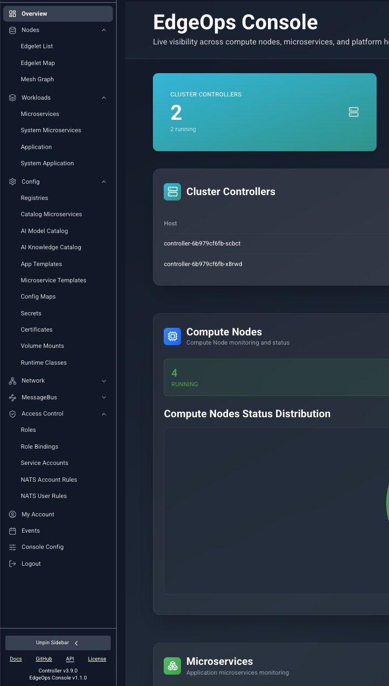
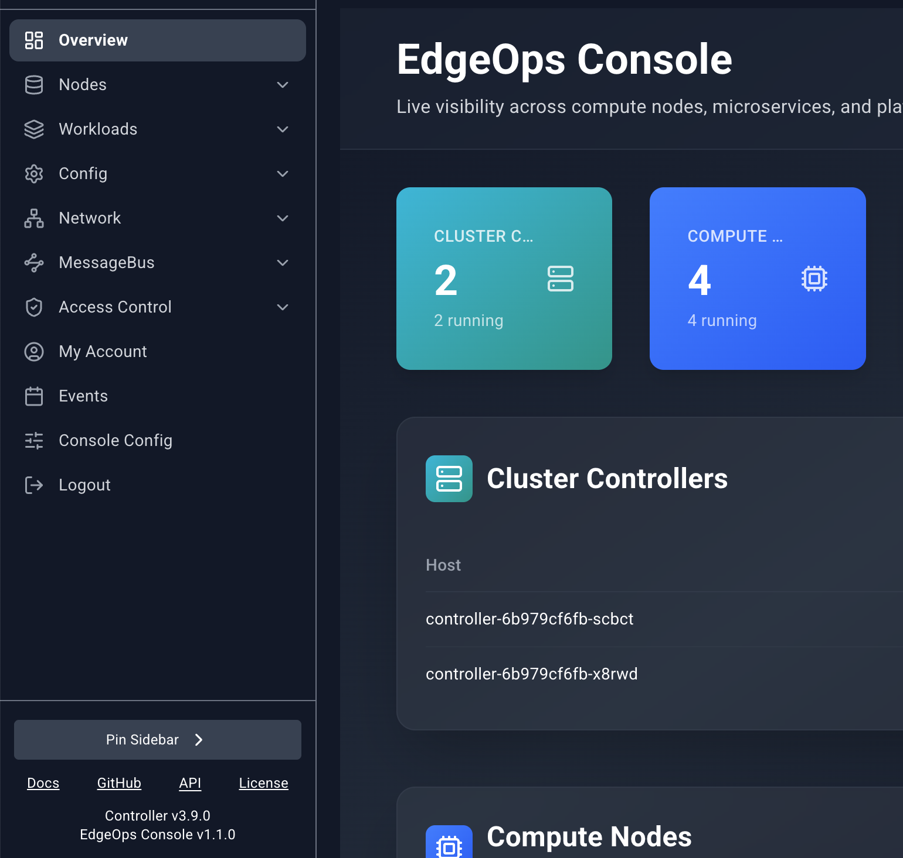
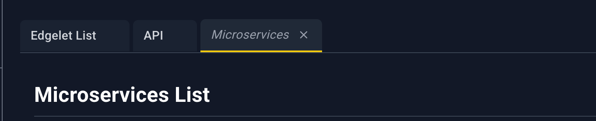
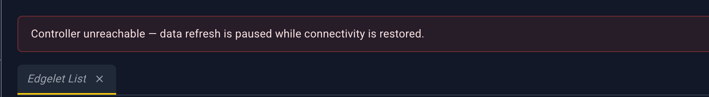
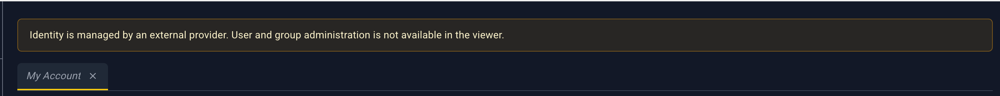
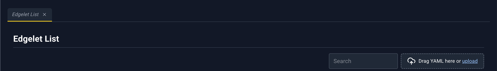
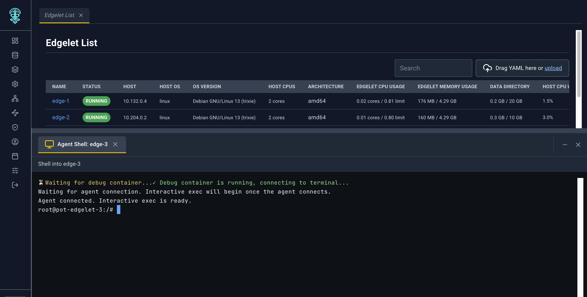
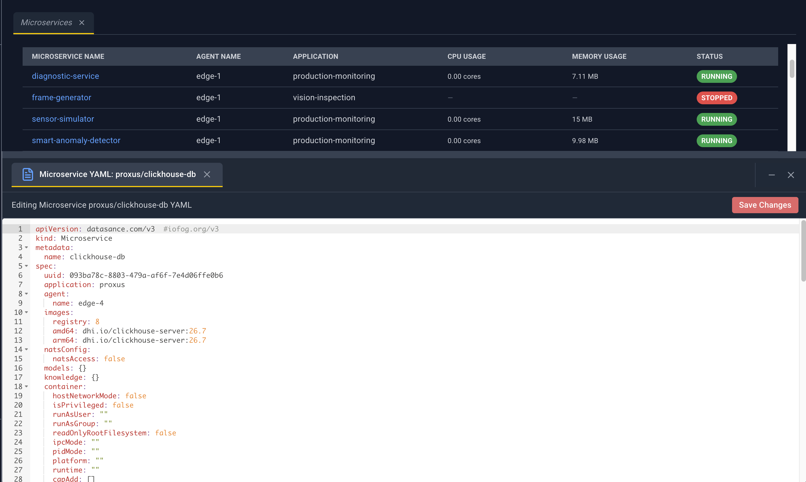

# The console shell

Every signed-in page sits in the same frame: a sidebar on the left, workbench tabs across the top of the content, and an optional drawer along the bottom for shells, logs, YAML, and template deploy forms.

## Sidebar

The sidebar starts collapsed. Move the pointer over it and it expands. Move away and it collapses again. **Pin Sidebar** keeps it open; **Unpin Sidebar** restores hover behavior. The logo at the top returns to **Overview**.

| Group | Pages | When it appears |
| --- | --- | --- |
| Overview | Overview | Always, at the top |
| Nodes | Edgelet List, Edgelet Map, Mesh Graph | Always |
| Workloads | Microservices, System Microservices, Application, System Application | Always |
| Config | Registries through Runtime Classes | Always |
| Network | Services | Always |
| MessageBus | Operators, Accounts, Users | Only when the Controller reports NATS |
| Access Control | Roles, Role Bindings, Service Accounts, NATS Account Rules, NATS User Rules | Always |
| IAM | My Account, Users, Groups | Only when the Controller uses its built-in identity provider |
| My Account | My Account | Standalone item when identity is external |
| Events | Events | Always, near the bottom |
| Console Config | Polling settings | Always, near the bottom |
| Logout | Ends the session | Always |

Choosing a page opens it as a workbench tab. Choosing it again focuses the tab you already have.

With the sidebar expanded, the footer shows **Docs**, **GitHub**, **API**, and **License**. Docs, GitHub, and License open in a new browser window. **API** opens a pinned Swagger tab inside the console. Under the links, the footer shows the Controller version and the EdgeOps Console version.

## Workbench tabs

The console keeps up to **12** tabs.

- A tab you open by browsing is a **preview**. Its title is italic. The next page you open replaces that preview, so casual browsing does not fill the bar.
- A tab stays put once something treats it as pinned. The API tab opens pinned. Opening a resource link focuses or creates a tab for that page.
- The active tab has a yellow underline. Click a tab to focus it. The address hash follows the active tab.
- **Close** (the X on a tab) is always visible on the active tab and appears on hover for the others.
- At 12 tabs, opening another page closes the oldest unpinned tab. If every tab is pinned, a new page does not open.

## Banners

When the Controller cannot be reached, a red banner says **Controller unreachable — data refresh is paused while connectivity is restored.** Lists and open detail panels stop polling until the connection returns.

When sign-in uses an external identity provider, Users, Groups, and My Account show an amber banner: **Identity is managed by an external provider. User and group administration is not available in the viewer.** The IAM group is hidden from the sidebar in that mode. My Account remains as its own item.

## Lists

Most resource pages are tables. They share one toolbar.

- **Search** filters the rows already loaded. It matches the text stored on each column, ignoring case. It does not match text that exists only inside a custom cell (a rendered link or a metric bar) unless that text is also the column’s value.
- **Drag YAML here or upload** accepts one `.yaml` or `.yml` file. See [YAML uploader](./12-yaml-uploader.md).
- An empty table says **No records found**.
- These lists do not paginate. Events is the exception; it has its own pager.
- There is no row checkbox and no “select all”.
- A loading overlay covers the page while the first fetch is in progress. The message names the resource, for example **Fetching Registries**.

### Opening a detail panel

Click the blue name (or URL, on Registries). That opens a panel from the right. The rest of the row is not a click target, except on Events, where the whole row opens the panel.

Other pages can deep-link here. A blue name in a detail panel opens the target list in a workbench tab and that list opens the matching panel. The address carries a query such as `agentId`, `microserviceId`, or `modelName`. You can paste the same query into the hash to reopen the panel later.

## Detail panel

The panel is a slide-over. A dim scrim covers the page. Click the scrim or the **X** to close it.

Drag the left edge to resize it. The width stays between 320 pixels and the window width minus a margin. Some pages open wider (agent and microservice panels open around 750 pixels; templates open around 900).

While the panel is open and the Controller is healthy, most panels refresh on the **Slideover Polling Interval** from Console Config. Message-bus rule panels and the topology-node panel do not poll.

Fields are label/value rows. A bold line is a section title. Some sections are nested tables. Blue underlined values are links: they open another workbench tab and, when the target page supports it, the detail panel for that resource.

### Header icons

Icons appear only when that page offers the action. Hover shows the name.

| Icon | Name | What it does |
| --- | --- | --- |
| Paperclip | Attach | Opens a dialog to link this resource to one or more edgelets. |
| Broken paperclip | Detach | Opens a dialog to unlink selected edgelets. |
| Terminal prompt | Terminal | Opens a shell. Agents ask how to start the session first. Microservices open a shell directly when the container is running. |
| Document | Logs | Opens **Configure Log Viewing**, then streams logs into the bottom drawer. |
| Key | Provision Key | Shows the edgelet provisioning key and the commands to install it. |
| Broom | Clean | Asks you to confirm a prune of unused images and local AI artifacts on that edgelet. |
| Upload | Publish | Opens the template deploy form in the bottom drawer. |
| Document with lines | Details | Reserved on the shared panel. Current pages do not wire it. |
| Pencil | Edit | Opens the resource YAML in the bottom drawer. **Save** writes it back. |
| Up/down arrows | Version change | Opens upgrade or rollback for an edgelet. |
| Play | Start | Shown when the workload is stopped. Asks you to confirm, then starts it. |
| Stop in a circle | Stop | Shown when the workload is running or activated. Asks you to confirm, then stops it. |
| Circular arrow | Restart | Asks you to confirm, then reboots an edgelet or rebuilds a microservice. On an application it stops the application, waits, and starts it again. |
| Trash | Delete | Asks you to confirm, then deletes the resource. |
| X | Close | Closes the panel. The close icon has no tooltip. |

Destructive icons (Stop, Delete) highlight red on hover. The others highlight with the console accent.

Each page chapter lists the icons that page actually shows and the exact confirm dialog.

## Bottom drawer

Shells, logs, YAML editors, and template deploy forms share one drawer at the bottom of the window. The page above shrinks so the drawer does not cover the list.

- Each session is a tab inside the drawer.
- A YAML or deploy tab shows `*` after the title while it has unsaved edits.
- **Save** on a YAML tab submits the editor contents. **Save** on a deploy tab asks you to confirm, then deploys.
- Drag the top edge of the drawer to change its height.
- Closing the last session collapses the drawer.

Log viewing uses this same drawer. You choose tail length and follow mode in **Configure Log Viewing** before the stream starts. See the agent and microservice chapters for the presets.

## Feedback

Actions report through toasts: success, warning, or error. A multi-resource YAML upload sends one toast per resource and a summary toast at the end.
