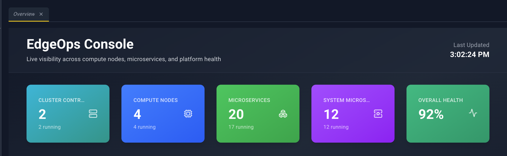
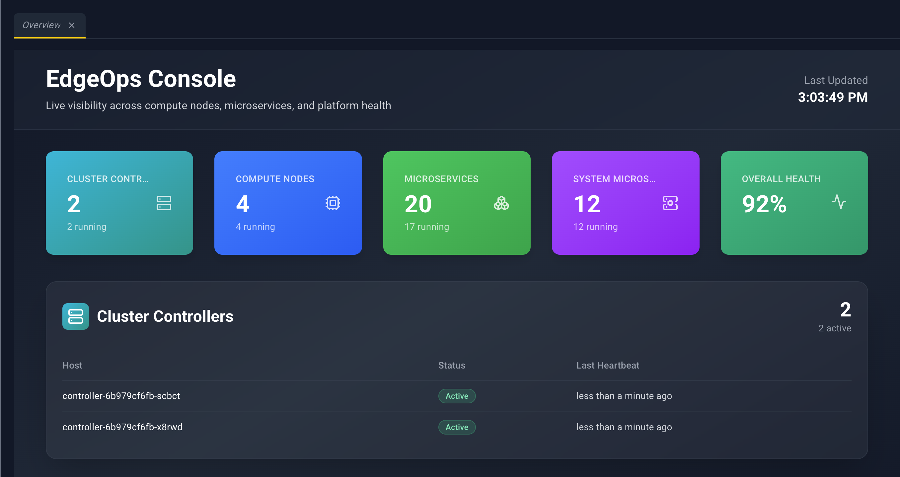
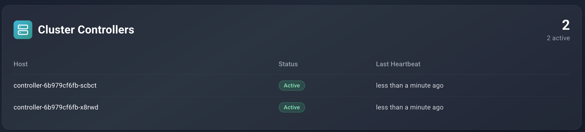
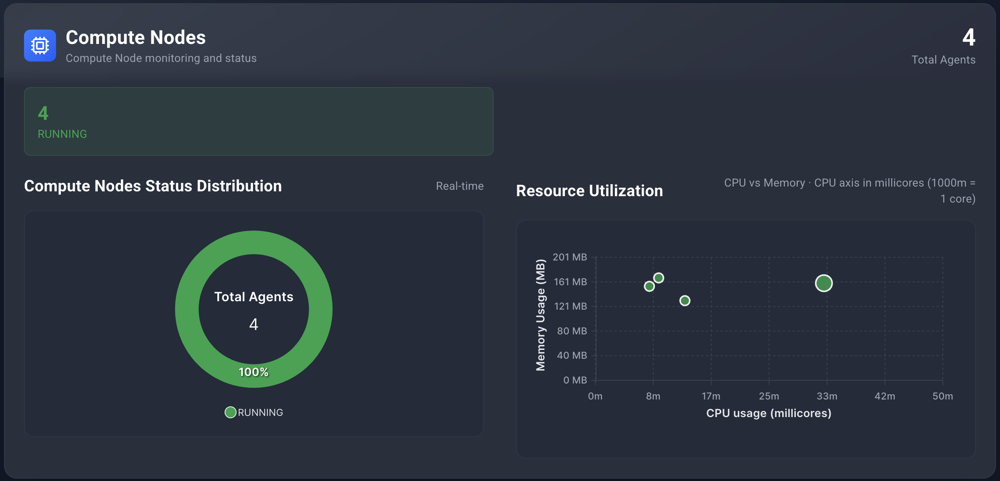
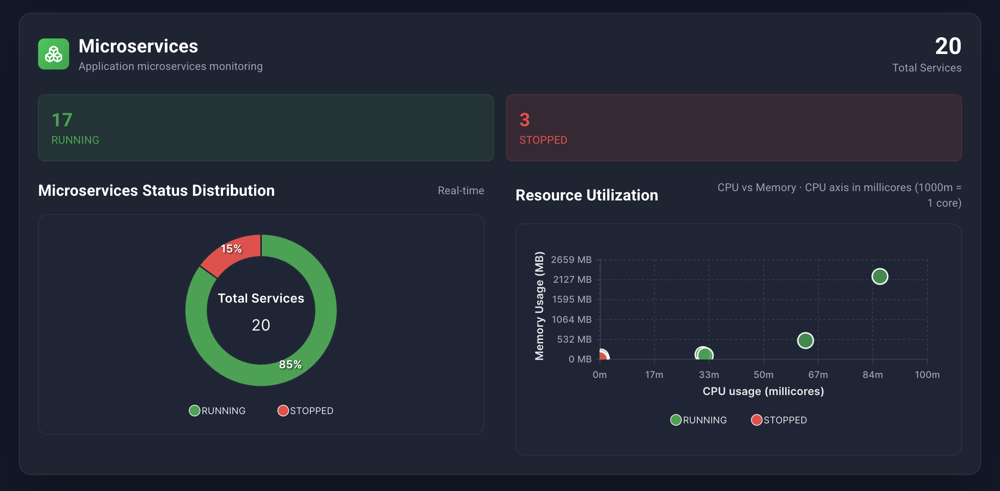
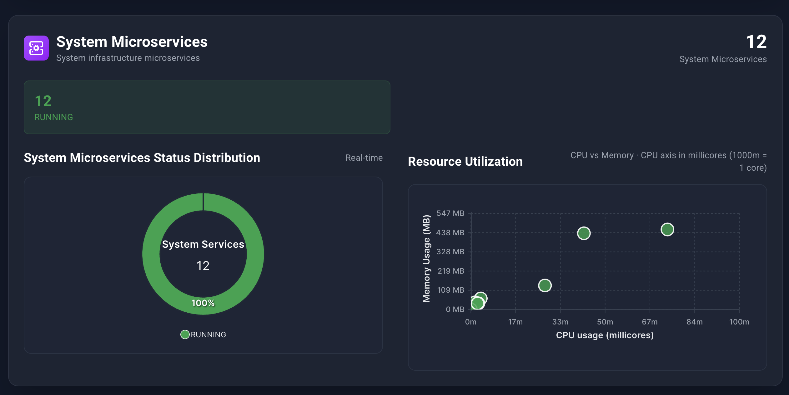

# Overview

**Sidebar:** Overview  
**Address:** `/#/dashboard`

Overview is the home page. It summarizes the cluster. The cards and charts do not open other pages; use the sidebar when you want a list or a detail panel.

The header stays pinned while you scroll. It shows **EdgeOps Console**, the line **Live visibility across compute nodes, microservices, and platform health**, and **Last Updated** with the clock from the moment the page rendered.

## Metric cards

| Card | What the large number is | Secondary line |
| --- | --- | --- |
| Cluster Controllers | How many controllers are reported | `{n} running` (controllers marked active). Hidden when the Controller does not send this data. |
| Compute Nodes | Edgelets known to the console | `{n} running` (daemon status Running) |
| Microservices | Microservices on user applications | `{n} running` |
| System Microservices | Microservices on system applications | `{n} running` |
| Overall Health | Percent of those three groups that are running | No secondary count |

Overall Health is running agents, plus running user microservices, plus running system microservices, divided by the totals of those three groups.

## Cluster controllers

Shown only when controller status is present. Each controller is marked **Active**, **Standby**, or **Stale**, with heartbeat information. This section is a status view. It does not open a detail panel.

## Compute nodes

Section title **Compute Nodes**, subtitle **Compute Node monitoring and status**. A **Total Agents** count sits with the section.

- Status chips count edgelets in each daemon status.
- **Compute Nodes Status Distribution** is a donut. The center repeats **Total Agents**. The legend is the status names.
- **Resource Utilization** is a bubble chart. Horizontal position is CPU usage in millicores. Vertical position is memory usage in megabytes. Hover a bubble for the edgelet name, status, CPU, memory, and disk.

If the cluster has no edgelets, the section says **No agents found**.

## Microservices

The user-microservice section uses the same two charts. The donut center says **Total Services**. The subtitle is **Application microservices monitoring**. A bubble tooltip includes **Application** and **Edge Node** plus CPU and memory.

Empty copy: **No microservices found** / **No microservice data is currently available**.

## System microservices

Same layout as the user microservice charts, for system workloads. Empty copy: **No system microservices found**.

Lists for these resources live under Workloads and Nodes. Overview does not deep-link into them.
