# Nodes

The Nodes group is how you see edgelets (compute nodes) and how they connect.

| Page | Address | Use it to |
| --- | --- | --- |
| Edgelet List | `/#/nodes/list` | Scan every edgelet and open its detail panel |
| Edgelet Map | `/#/nodes/Map` | See edgelets that reported a location |
| Mesh Graph | `/#/nodes/mesh-graph` | See router and NATS links |

The agent detail panel is the same on the list, the map, and the mesh graph. It is documented once, after the three pages.

## Edgelet List

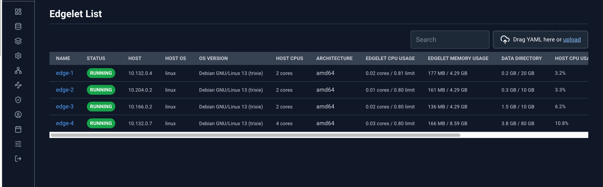

The page title is **Edgelet List**. The table lists every edgelet. System edgelets sort first, then names alphabetically. The list refreshes on the main polling interval.

### Toolbar

Search, plus the YAML dropzone. An uploaded `Agent` document updates that edgelet and the list picks it up on the next poll. There is no Create button on this page; new edgelets join by provisioning, and existing ones are edited from the detail panel or by YAML.

### Table

| Column | What it shows |
| --- | --- |
| Name | Edgelet name. This is the link that opens the detail panel. |
| Status | Daemon status pill. An amber triangle means a CPU, memory, or disk limit violation. Hover the triangle for `Limit violation: …`. |
| Host | Host name, or the IP address when the host name is empty |
| Host OS | Operating system |
| OS Version | OS version |
| Host CPUs | Logical CPU count, as `{n} core` or `{n} cores` |
| Architecture | Architecture label (auto, amd64, arm64, riscv64, arm) |
| Edgelet CPU Usage | Edgelet CPU usage against its limit |
| Edgelet Memory Usage | Edgelet memory usage against its limit |
| Data Directory | Edgelet data-directory usage against its limit |
| Host CPU Usage | Host CPU bar |
| Host Memory | Host memory bar |
| Host Disk (FS) | Host filesystem disk bar |
| Version | Edgelet version string |

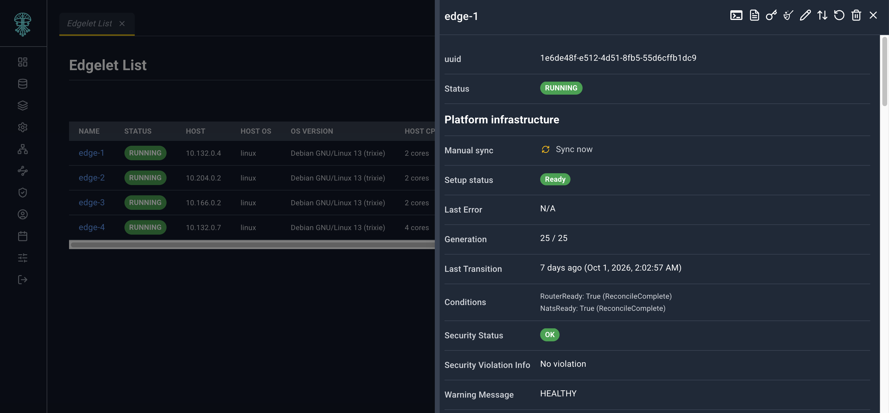

Click **Name**. A link from another page that uses `?agentId=` opens the same panel when that edgelet is in the list.

Host metric bars are inventory. They are not an Edge Guard attestation. The detail panel says this in a footnote.

## Edgelet Map

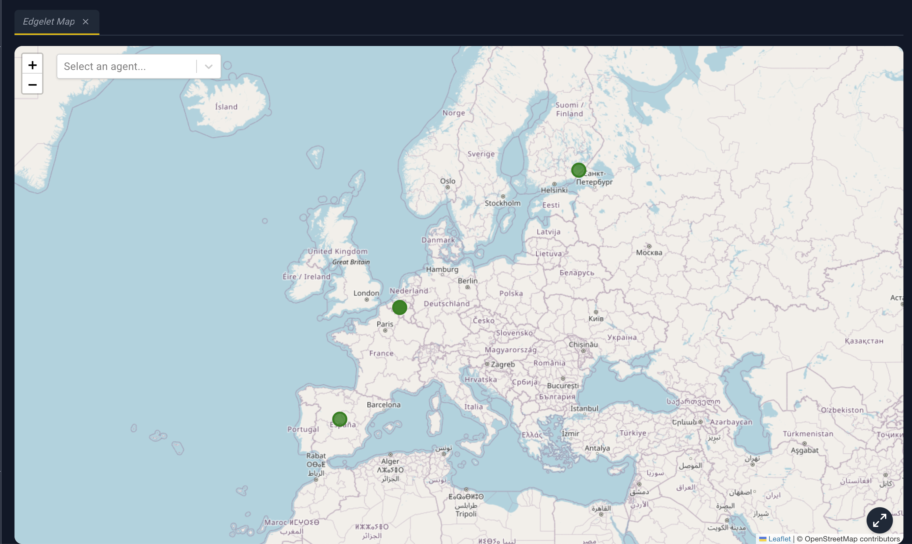

**Edgelet Map** plots edgelets that have latitude and longitude. Edgelets without coordinates are absent from the map and from the selector.

### What you can do

- **Select an agent...** chooses an edgelet, flies the map to it, and opens the agent detail panel. Clear the selector to dismiss that choice.
- Scroll to zoom. Drag to pan. The map opens framed on all markers, or on the Controller location when no markers have coordinates.
- Click a marker to select it and zoom in. A card at the bottom shows the name, ID, and location.
- **Detail** on that card opens the agent detail panel. Clicking the marker alone does not.
- **Reset map view** (bottom-right) frames the markers again.

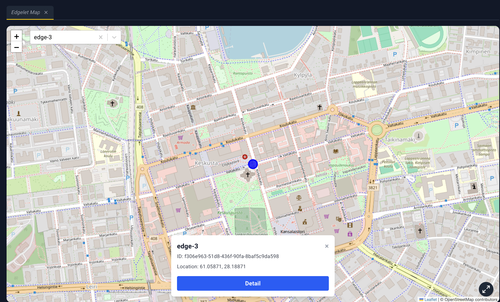

Marker color:

| Color | Meaning |
| --- | --- |
| Orange | Platform reconcile warning |
| Green | Daemon is Running and healthy |
| Amber | Running, with a warning that is not a healthy state |
| Red | Not running |

There is no YAML dropzone on the map.

## Mesh Graph

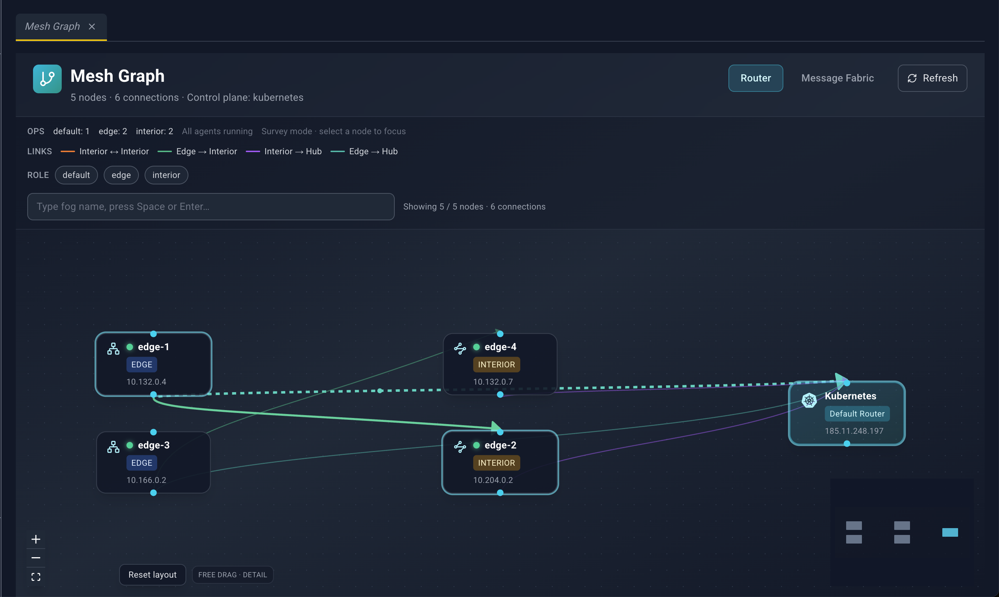

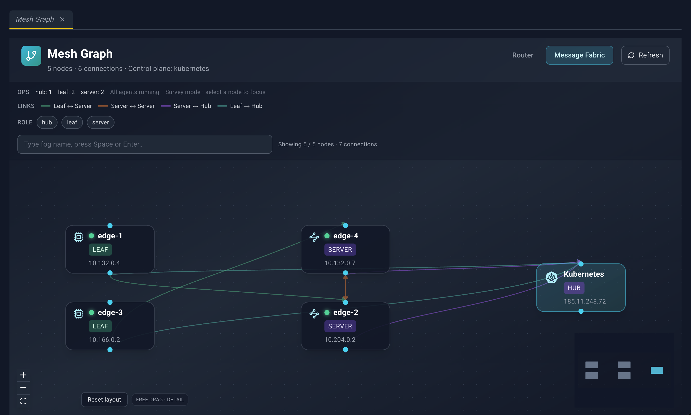

**Mesh Graph** draws how nodes connect. It has two layers:

- **Router** — interior routers, edge routers, and hubs.
- **Message Fabric** — NATS servers, leaves, and hubs.

The subtitle shows `{n} nodes · {n} connections`, and the control-plane name when the summary includes one. **Refresh** reloads the summary and the active layer. A layer that is reloading shows **Refreshing…**.

The graph does not use the main list poll. Use **Refresh**, or leave and come back, to pick up topology changes.

### Filters

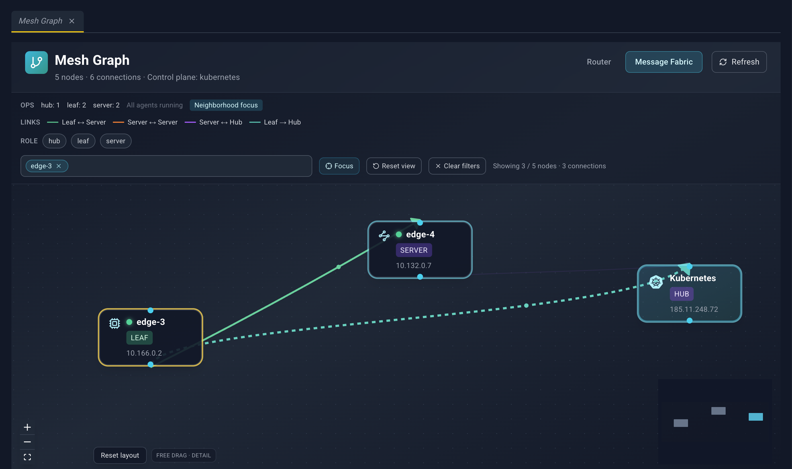

Each layer keeps its own filters.

- Role counts, from the full layer, sit on the first row.
- **{n} degraded** counts topology nodes tied to an edgelet whose daemon is not Running. Otherwise the line says **All agents running**.
- **Neighborhood focus** means a node is selected and the graph highlights its neighborhood. **Survey mode · select a node to focus** means nothing is selected.
- The legend names link colors:
  - Router: **Interior ↔ Interior**, **Edge → Interior**, **Interior → Hub**, **Edge → Hub**
  - Message Fabric: **Leaf ↔ Server**, **Server ↔ Server**, **Server ↔ Hub**, **Leaf → Hub**
- Role chips toggle which roles stay visible. Router roles are **default**, **edge**, and **interior**. Message Fabric roles are **hub**, **leaf**, and **server**.
- **Type fog name, press Space or Enter…** adds a fog-name badge. Matching is a case-insensitive prefix of the fog name or the display name.
- **Focus** (crosshair) centers the graph on the fog-name matches.
- **Reset view** clears the selection and the filters.
- **Clear filters** clears filters and leaves the selection behavior to reset separately when you use that control.
- The count line reads **Showing {visible} / {total} nodes · {connections} connections**.

If nothing matches, the canvas says **No nodes match the current filters.** A failed load shows the error and **Retry**.

### The canvas

Nodes show an icon, a title, and a role badge. A node tied to an edgelet also has a health dot: green when Running, amber for any other daemon status, gray when status is unknown. Zoomed in far enough, the host line appears under the title. The zoom label in the corner reads **Free drag · overview**, **standard**, or **detail**.

Spoke nodes can collapse into a group (a users icon, **Click to expand**, and the upstream name). Click the group to expand it and focus that upstream node.

Edges are bundled and colored by the legend. When you select or hover a node, the path toward the hub animates.

You can:

- Pan and zoom, including the minimap and the zoom controls.
- Drag nodes. Positions stay until you click **Reset layout**.
- Click a node to highlight its neighborhood and trace the path to the hub. That click also opens a detail panel (below).
- Hover a node to preview the neighborhood when nothing is selected.
- Click empty canvas to clear the selection and close both detail panels.

### Which panel opens

| The node has an edgelet id | Panel |
| --- | --- |
| Yes | The full agent detail panel |
| No | The topology node panel |

#### Topology node panel

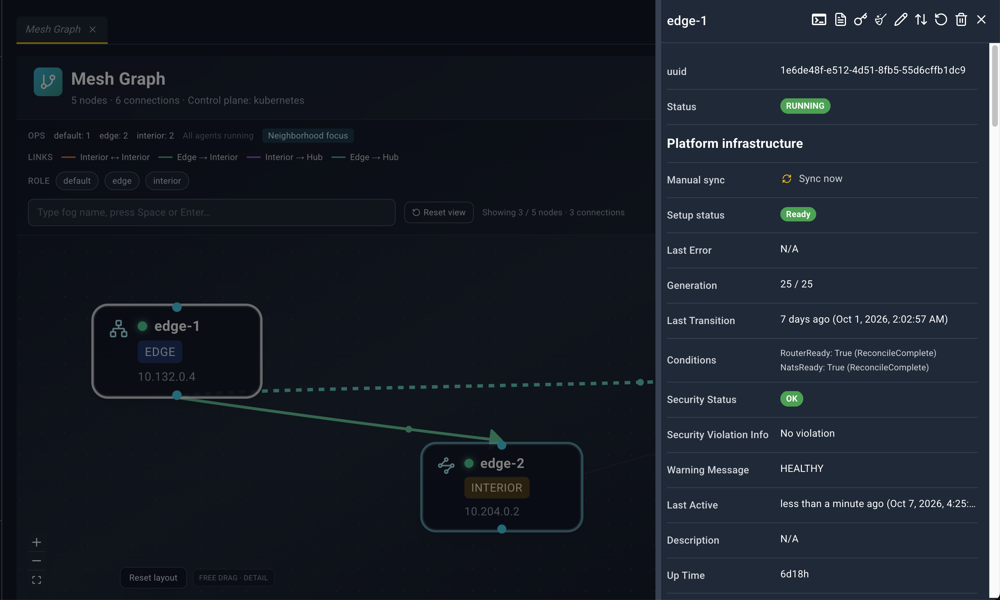

Title is the display name, or **Topology Node**. While the detail is loading, the title is **Loading…**. The header has a close icon and no other actions.

| Field | Meaning |
| --- | --- |
| Display Name | Name drawn on the node |
| Role | Router or NATS role |
| Mode | Node mode |
| Deployment | Where this node is deployed |
| Host | Host, or **N/A** |
| Connections | `{n} upstream · {n} downstream` |
| Agent | When the node is tied to an edgelet: a link to Edgelet List that opens that agent. The label is the fog name, or the id. |

Router nodes can also show **Messaging port**, **Edge router port**, and **Inter-router port**.

Message Fabric nodes can also show **Server port**, **Leaf port**, **Cluster port**, **MQTT port**, **HTTP port**, **JS storage**, and **JS memory store**.

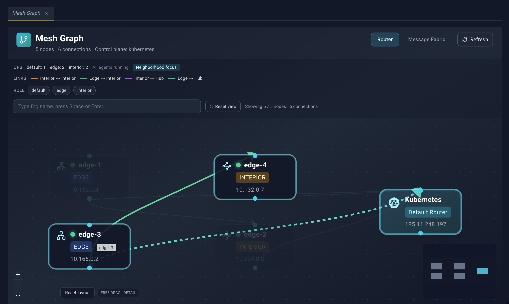

## Agent detail panel

Opened from Edgelet List, Edgelet Map (**Detail** or the selector), and Mesh Graph (a node that has an edgelet). The panel loads the full edgelet record when it opens, then keeps refreshing.

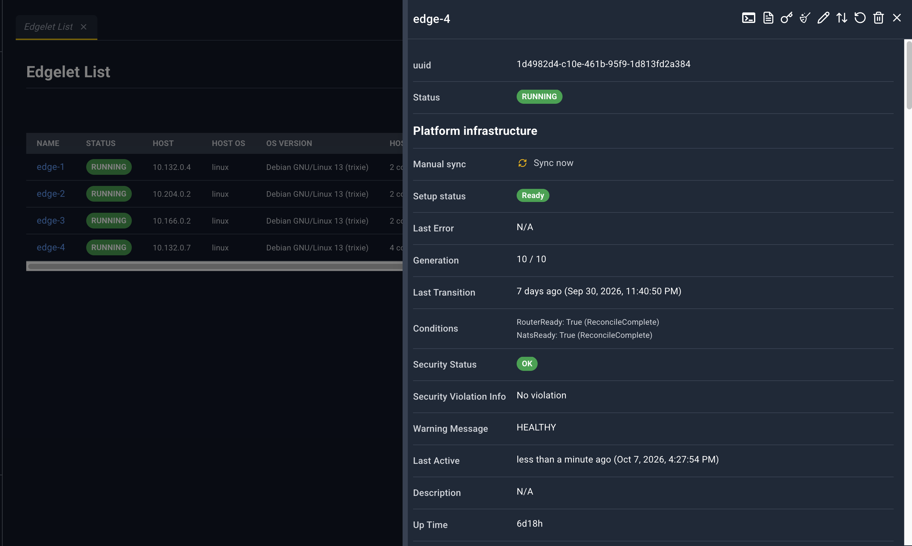

Title is the edgelet name, or **Agent Details**.

### Header icons

| Icon | Name | What happens |
| --- | --- | --- |
| Terminal | Terminal | If the daemon is not running, an error toast appears and nothing opens. If it is running, **Configure Exec Session** opens. |
| Document | Logs | **Configure Log Viewing**, then a log stream for this edgelet. |
| Key | Provision Key | **Provision Key - {name}**. |
| Broom | Clean | Confirm prune. |
| Pencil | Edit | YAML tab titled `AgentConfig YAML: {name}`. Save updates the edgelet. |
| Up/down arrows | Version change | **Version Change**. |
| Circular arrow | Restart | Confirm, then reboot the edgelet. |
| Trash | Delete | Confirm, then delete the edgelet. |
| X | Close | Closes the panel. |

These icons stay available on system and controller edgelets. Delete and version change add a stronger warning for those nodes. Attach, Detach, Publish, Start, and Stop are not on this panel.

### Fields

Sections, in order:

1. Identity and health — uuid, **Status**, **Manual sync**, **Setup status**, **Last Error**, **Generation**, **Last Transition**, **Conditions**, **Security Status**, **Security Violation Info**, **Warning Message**, **Last Active**, **Description**, **Up Time**
2. **Platform infrastructure** continues those platform fields where the layout groups them
3. **Agent Details** — **Host**, **Version**, **Mode** (`System` or `Node`), **Deployment Type**, **Container Engine**, **Architecture**, **IP Address**, **IP Address External**, **Tags**, **Created**
4. **Host** — **Logical CPUs**, **Host OS**, **OS version**, **Kernel** (Linux only; otherwise **N/A**), **Host CPU usage**, **Host memory**, **Host disk (FS)**. Footnote: *Host fields are informational inventory, not Edge Guard attestation.*
5. **Edgelet stack** — **Edgelet CPU usage**, **CPU violation**, **Edgelet memory usage**, **Memory violation**, **Data directory**, **Data directory path**, **Disk violation**. Footnote: *Data directory usage is Edgelet policy storage, not the host filesystem totals above.*
6. **Volume Mounts**
7. **Applied Runtime Classes**
8. **AI model status**
9. **AI Knowledge status**
10. **Status** (runtime) — **Available Runtimes**, **Available CDI devices**, **Runtime Agent Phase**, **Control Plane Quiesced**, **GPS Status**, **Is Ready To Rollback**, **Is Ready To Upgrade**, **Last Status Time**
11. **Applications**
12. **Microservices**
13. **System Applications**
14. **System Microservices**

**Manual sync** is the button **Sync now**. Its tooltip is *Re-applies router and NATS platform configuration for this node.* **Generation** shows observed generation over desired generation, and `(in progress)` while they differ. **Conditions** lists `type: status (reason)`. Violations are **Yes** or **No**.

### Linked tables

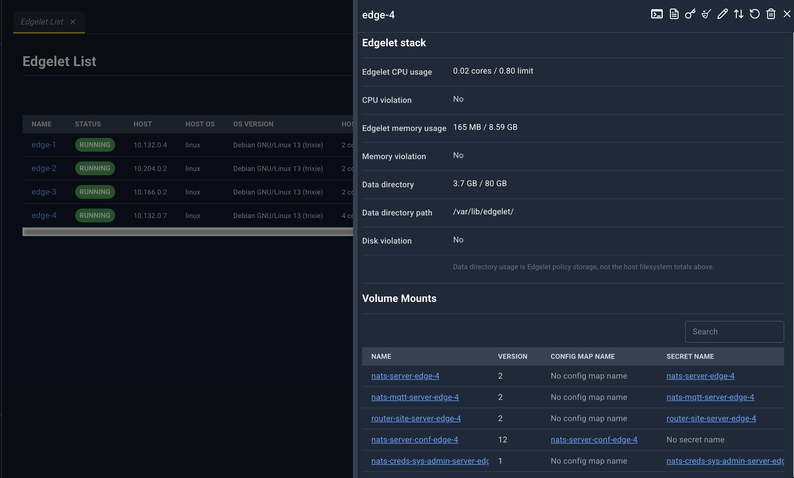

Empty sections say **No volume mounts…**, **No microservices available.**, or **No {resource} found for this agent.**

| Section | Columns | Blue links open |
| --- | --- | --- |
| Volume Mounts | Name, Version, Config Map Name, Secret Name | Volume Mounts, Config Maps, Secrets |
| Applied Runtime Classes | Name, Handler, Source | Runtime Classes |
| AI model status | Name, Source, State, Digest, Resolved Revision, Revision Floating, Total Bytes, Last Error | AI Model Catalog, when source is managed |
| AI Knowledge status | Same shape as models | AI Knowledge Catalog, when source is managed |
| Applications | Application Name, Status (`ACTIVE` / `INACTIVE`) | Application list, that application |
| Microservices | Name, Status, Agent, Ports | Microservices list, that microservice |
| System Applications | Application Name, Status | System Application list |
| System Microservices | Name, Status, Agent, Ports | System Microservices list |

Ports in the microservice tables render as `internal:external/protocol`.

### Dialogs

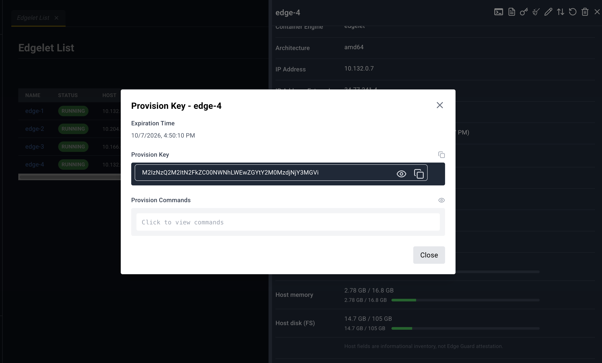

**Provision Key - {name}** loads the key, then shows:

- **Expiration Time**
- **Provision Key** with copy
- **CA Certificate (Base64)** with copy, masked until revealed
- **Provision Commands** — hidden until you reveal them. The commands configure the edgelet and run provision.

Close dismisses the dialog.

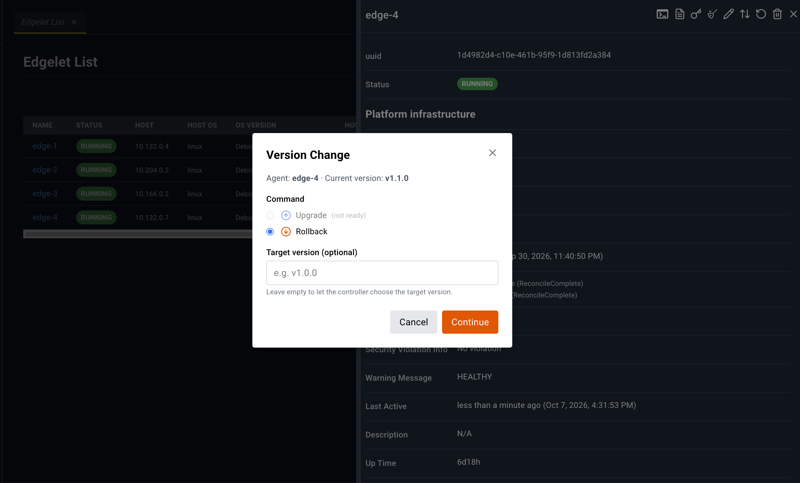

**Version Change** shows the current version. A critical edgelet (system, or one hosting the controller microservice) shows an extra warning. If neither upgrade nor rollback is ready, the dialog says so and both choices stay disabled with `(not ready)`.

- **Command:** Upgrade or Rollback
- **Target version (optional)**, placeholder `e.g. v1.0.0`
- **Continue** opens a second confirm titled **Confirm version change**, with **Upgrade** or **Rollback**

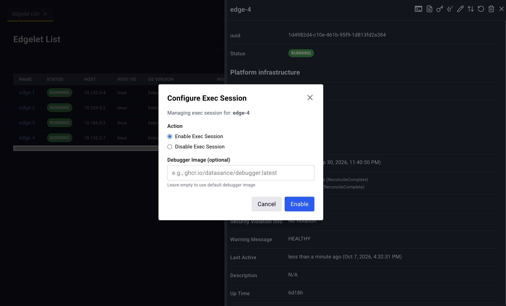

**Configure Exec Session**

- **Action:** Enable Exec Session or Disable Exec Session
- **Debugger Image (optional)** when enabling, placeholder `e.g., ghcr.io/datasance/debugger:latest`

Enable starts a bottom-drawer tab **Agent Shell: {name}**. Disable ends the exec session.

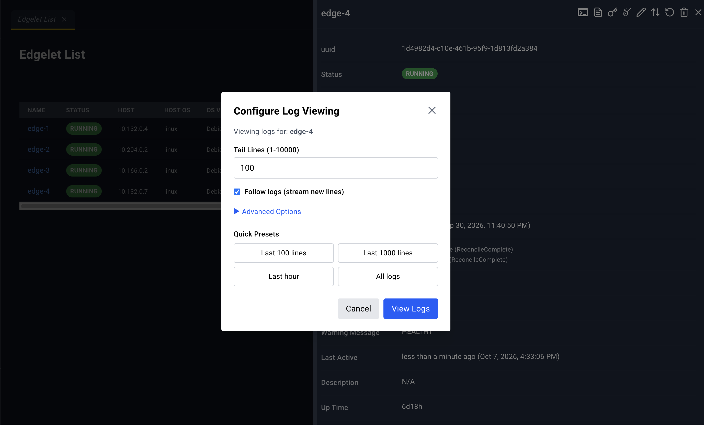

**Configure Log Viewing**

- **Tail Lines (1-10000)**
- **Follow logs (stream new lines)**
- **Advanced Options:** **Since (optional)**, **Until (optional)**
- Presets: **Last 100 lines**, **Last 1000 lines**, **Last hour**, **All logs**
- **View Logs** opens the stream in the bottom drawer

**Restart {name}** — *This action will restart the agent node.* Confirm with **Restart**.

**Pruning Agent {name}** — confirms removal of unused images and local AI models and knowledge on that node. Fleet-managed copies are not removed. Confirm with **Prune**.

**Deleting Agent {name}** — warns that the edgelet and the microservices and applications on it will be removed. A system or controller edgelet adds: *Warning: This is a system or controller agent…* Confirm with **Delete**.

**Sync now** does not use that confirm dialog. It re-applies platform configuration and then refreshes the panel.
