# Workloads

Workloads are applications and the microservices inside them. User workloads and system workloads are separate lists. System lists include the platform’s own applications, including the controller microservice.

| Page | Sidebar title | Address |
| --- | --- | --- |
| Application List | Application | `/#/Workloads/ApplicationList` |
| System Application List | System Application | `/#/Workloads/SystemApplicationList` |
| Microservices List | Microservices | `/#/Workloads/MicroservicesList` |
| System Microservices List | System Microservices | `/#/Workloads/SystemMicroservicesList` |

All four pages have Search and the YAML dropzone. None of them has a Create button. You add workloads by uploading YAML or by deploying a template (see [Catalog and templates](./05-catalog-and-templates.md)).

A name in another panel can open these lists with `applicationId` or `microserviceId` and pop the matching detail panel.

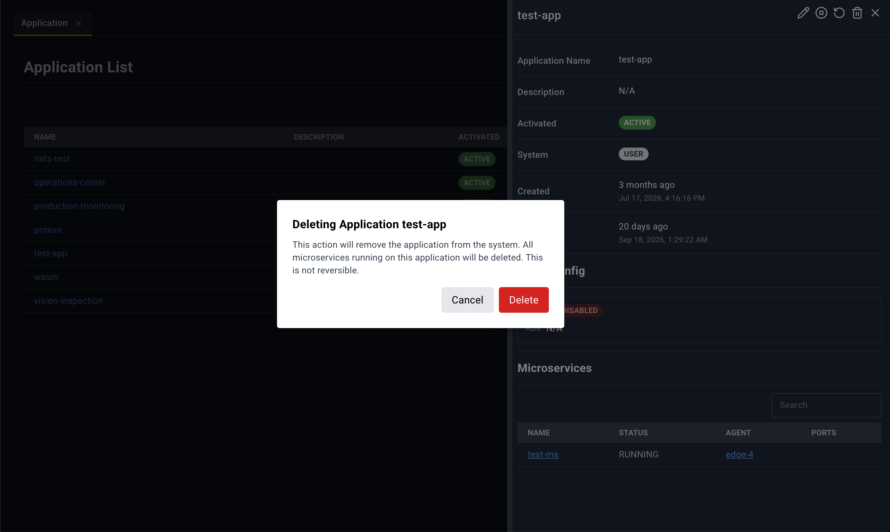

## Application List

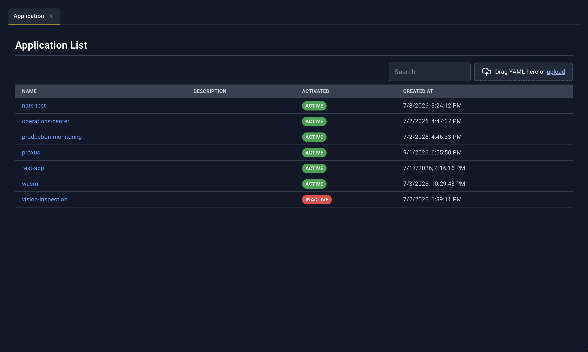

User applications only.

| Column | What it shows |
| --- | --- |
| Name | Application name. Click to open the detail panel. |
| Description | Description text |
| Activated | Pill **ACTIVE** or **INACTIVE** |
| Created At | Local date and time |

### Application detail panel

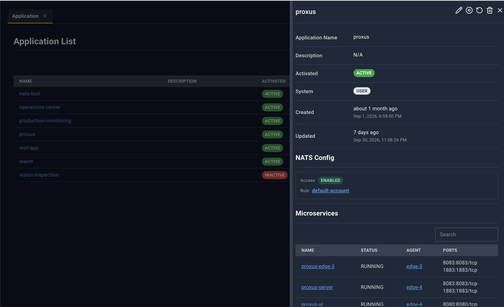

Title is the application name, or **Application Details**.

| Icon | Name | What happens |
| --- | --- | --- |
| Pencil | Edit | YAML tab `Application YAML: {name}`. Save asks you to confirm. The warning explains that this save applies application-level fields (description, activation, system flag, NATS config). Microservice edits inside that YAML are not applied by this save; upload a full application document when you need to change microservices. |
| Play or Stop | Start or Stop | Play when the application is inactive, Stop when it is active. Confirm dialog title is `ACTIVE {name}` or `INACTIVE {name}`. The confirm button uses that same word. |
| Circular arrow | Restart | **Restarting Application {name}**. The console deactivates the application, waits, then activates it again. |
| Trash | Delete | **Deleting Application {name}**. Deletes the application and its microservices. |
| X | Close | Closes the panel. |

Fields:

- **Application Name**, **Description**, **Activated**, **System** (pill **SYSTEM** or **USER**), **Created**, **Updated** (relative time plus a full timestamp)
- **NATS Config** — **No NATS config.** when empty. Otherwise **Access** is **ENABLED**, **DISABLED**, or **N/A**, and **Rule** links to NATS Account Rules for that rule.
- **Microservices** — **No microservices available.** or a table:

| Column | Link |
| --- | --- |
| Name | Microservices list, that microservice |
| Status | Status text |
| Agent | Edgelet List, that edgelet |
| Ports | `internal:external/protocol` on each line |

## System Application List

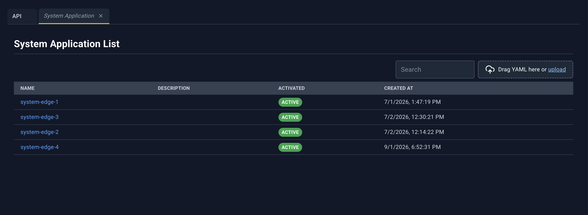

Same table as Application List, for system applications. The detail panel matches the user application panel, with two differences:

- The YAML tab is titled `System Application YAML: {name}`.
- Microservice names link to **System Microservices**, not the user microservice list.

Header icons are the same: Edit, Start or Stop, Restart, Delete, Close.

Restart is titled **Restart {name}**. Delete is titled **Delete {name}** and uses the system application delete. Start and Stop use the same ACTIVE / INACTIVE confirm, and the message says the action will start or stop the application.

YAML upload on this page can create a system application. Editing an existing one from the pencil patches the application.

## Microservices List

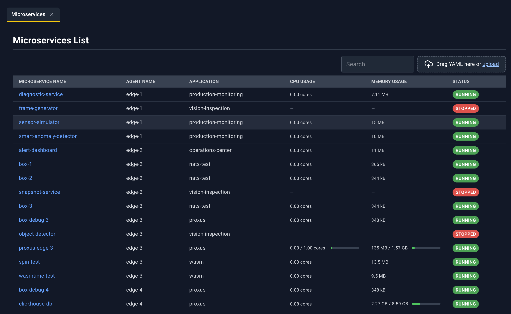

Every microservice from every user application, in one table. Rows sort with system edgelets first, then by edgelet name, then by microservice name.

| Column | What it shows |
| --- | --- |
| Microservice Name | Name. Click to open the detail panel. |
| Agent Name | Edgelet the microservice is scheduled on |
| Application | Parent application |
| CPU Usage | Current CPU for the container |
| Memory Usage | Current memory for the container |
| Status | Status pill. **PULLING** is yellow and can include a percentage. |

### Microservice detail panel

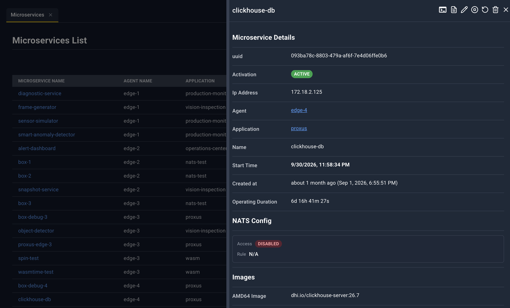

Title is the microservice name, or **Microservice Details**. The panel refreshes while it is open.

| Icon | Name | What happens |
| --- | --- | --- |
| Terminal | Terminal | Requires status **RUNNING**. Otherwise an error toast. Opens a bottom-drawer tab **Microservice Shell: {application}/{name}**. |
| Document | Logs | **Configure Log Viewing** for this microservice, then the log stream. |
| Pencil | Edit | YAML tab `Microservice YAML: {application}/{name}`. Save updates this microservice. |
| Play or Stop | Start or Stop | Stop when the microservice is activated, Start when it is not. Confirm title is `Stop {name}` or `Start {name}`. |
| Circular arrow | Restart | **Rebuilding Microservice {name}**. Confirm **Rebuild**. The image is pulled again and the microservice restarts. |
| Trash | Delete | **Deleting Microservice {name}**. |
| X | Close | Closes the panel. |

#### Sections and links

**Microservice Details**

| Field | Notes |
| --- | --- |
| uuid | Microservice id |
| Activation | **ACTIVE** or **INACTIVE** |
| Ip Address | From the live status |
| Agent | Link to Edgelet List for `agentId` |
| Application | Link to Application List for that application |
| Name | Microservice name |
| Start Time | When the current run started |
| Created at | Creation time |
| Operating Duration | Uptime as days, hours, minutes, seconds |

**NATS Config** — same shape as an application, but **Rule** links to **NATS User Rules**.

**Images** — **AMD64 Image**, **ARM64 Image**, **RISCV64 Image**, **ARM Image**. **Registry** links to Registries. **Catalog Item Id** links to Catalog Microservices.

**Container** — unset values show **N/A**.

| Field | Link |
| --- | --- |
| Runtime | Runtime Classes, when a runtime class name is set |
| Commands, Entrypoint, Working Dir | Process settings |
| Run As User, Run As Group | User and group |
| Read Only Root Filesystem | Yes/no style value |
| CPUs, Memory Limit, Memory Reservation, Memory Swap, SHM Size | Resource limits |
| CDI Devices | Chips |
| Host Network Mode, Privileged, Platform | Runtime flags |

**Status** — status pill and **Health Check Status**. When the microservice has crash data, the panel also shows **Current Error**, **Last Crash**, **Last Crash At**, and **Restarts**.

**Exec Session Ids** (chips), **Container Id**, **Pod Id** (only when a pod id is present), **Exec Status**, **Active Exec Session Id**.

**Resource Utilization** — **Container CPU**, **Container memory**.

#### Ports

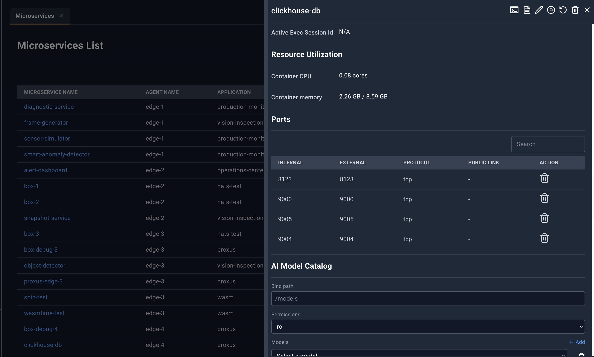

| Column | Meaning |
| --- | --- |
| Internal | Container port |
| External | Host port |
| Protocol | Protocol |
| Public Link | Opens the published address in the browser |
| Action | Trash. Confirm **Deleting Port {internal}** — *This action will remove the port from the microservice.* |

#### AI Model Catalog

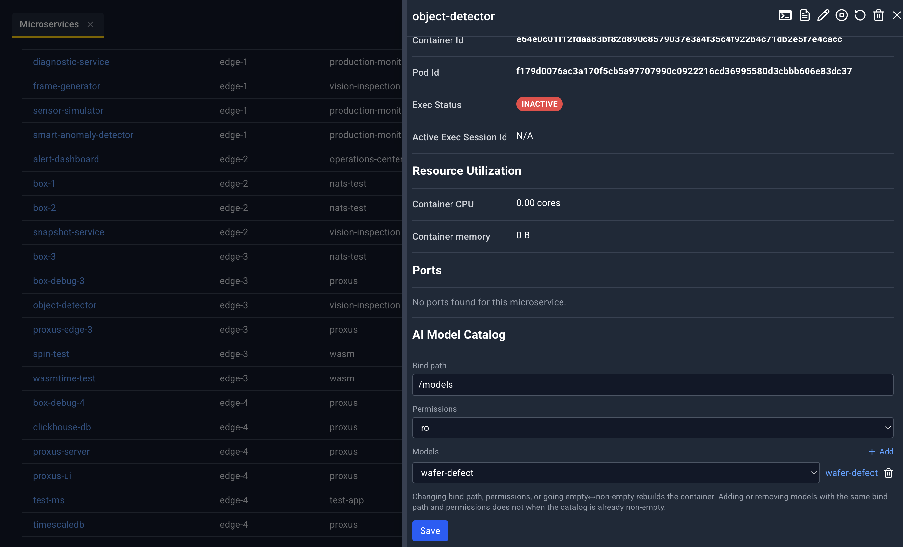

Only on user microservices.

- **Bind path**, placeholder `/models`
- **Permissions**, `ro` or `rw`
- **Models** — **Add**, a **Select a model** picker, a link to that model in AI Model Catalog, and **Remove model**
- A hint explains that changing the bind path or permissions, or going from no models to some (or the reverse), rebuilds the container
- **Save** writes the catalog attachment. Success toast: **AI Model Catalog updated**.

#### AI Knowledge Catalog

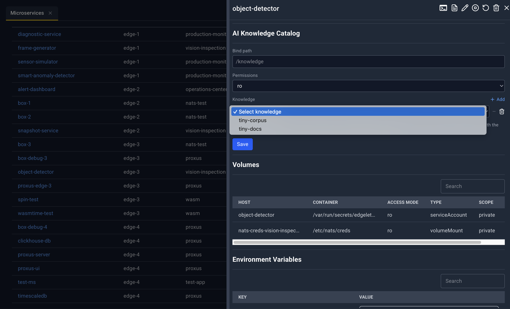

- **Bind path**, placeholder `/knowledge`
- **Permissions**
- **Knowledge** rows — **Select knowledge**, a link to AI Knowledge Catalog, **Remove knowledge**
- The same style of rebuild hint as models
- **Save** updates the attachment. The console rejects a bind path that collides with models, volumes, or tmpfs and shows that error in a toast.

#### Volumes

| Column | Meaning |
| --- | --- |
| Host | Host path or source |
| Container | Container destination |
| Access Mode | How the mount is exposed |
| Type | Volume type |
| Scope | Scope |
| Action | Trash, except for type `serviceAccount` (those mounts are injected and cannot be removed here) |

Confirm **Deleting Volume {host}**. Success toast: **Volume Deleted**. The panel closes after a successful delete.

#### Environment variables and extra hosts

**Environment Variables** — **Key** and **Value**. Values can be revealed or copied.

**Extra Hosts** — **Name**, **Address**, **Value**.

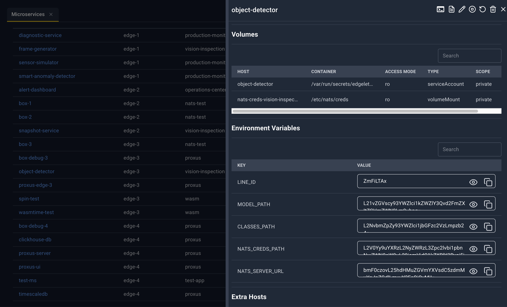

#### Config

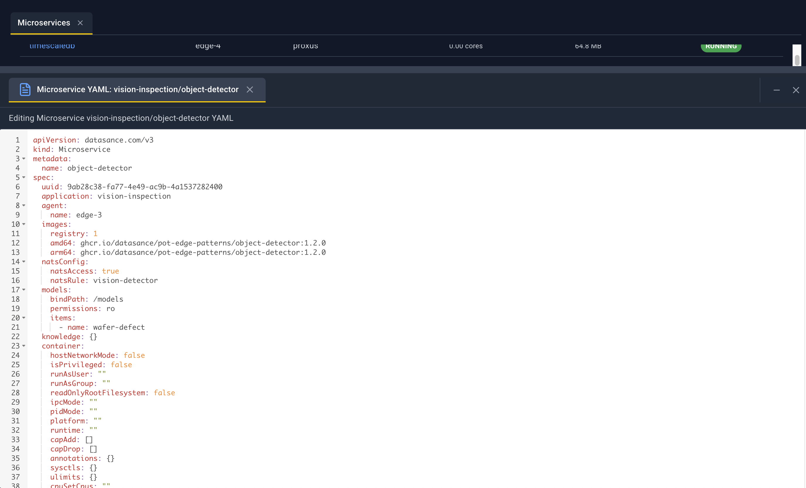

A YAML editor for this microservice’s config. The heading shows the config id. Edit the text and a pencil appears; that saves the config. The trash icon deletes the config.

### Log dialog

Same **Configure Log Viewing** dialog as on an edgelet: tail, follow, since/until, and the presets **Last 100 lines**, **Last 1000 lines**, **Last hour**, **All logs**. The last choices you made for microservices are remembered in the browser.

## System Microservices List

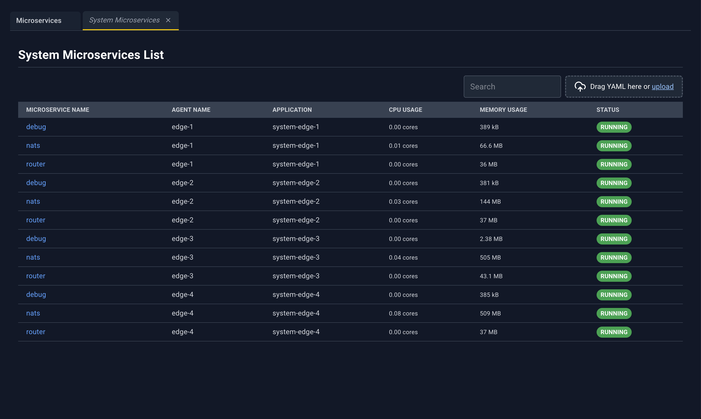

Same columns as Microservices List. A microservice that is the controller shows a **Controller** pill beside the name.

The detail panel matches the user microservice panel, with these differences:

| Area | System microservice behavior |
| --- | --- |
| Application link | Opens System Application List |
| Container section | Not shown |
| AI Model Catalog and AI Knowledge Catalog | Not shown |
| Terminal | Shell title starts with **System Microservice Shell:** |
| Logs | System microservice log stream |
| Edit | YAML tab `System Microservice YAML: …`. Save updates the system microservice. |
| Start / Stop | Not on this panel |
| Restart | Rebuilds the system microservice. Dialog title **Rebuild {name}**. |
| Delete | Hidden when the microservice is the controller. Otherwise **Delete {name}**. |
| Port trash | Hidden on the controller microservice. Confirm title **Delete Port {internal}** and the message refers to the port mapping. |
| Volume trash | Hidden on the controller, and hidden for `serviceAccount` mounts |
| Config trash | Hidden on the controller |

YAML upload on this page refreshes the microservice lists. The pencil on an existing system microservice updates that microservice; it does not offer a create path from the editor.
