# Catalog and templates

These pages live in the Config group. They describe images, models, knowledge, and the templates you deploy from. Every list has Search and the YAML dropzone. None of them has a Create button. You add records by uploading YAML. You deploy a running workload from a template with **Publish**.

| Page | Sidebar title | Address | Deep link |
| --- | --- | --- | --- |
| Registries | Registries | `/#/config/Registries` | `registryId` |
| Catalog Microservices | Catalog Microservices | `/#/config/CatalogMicroservices` | `catalogItemid` |
| AI Model Catalog | AI Model Catalog | `/#/config/Models` | `modelName` |
| AI Knowledge Catalog | AI Knowledge Catalog | `/#/config/Knowledge` | `knowledgeName` |
| Application Templates | App Templates | `/#/config/AppTemplates` | — |
| Microservice Templates | Microservice Templates | `/#/config/MicroserviceTemplates` | `microserviceTemplateName` |

Click the name (or the URL, on Registries) to open the detail panel.

## Registries

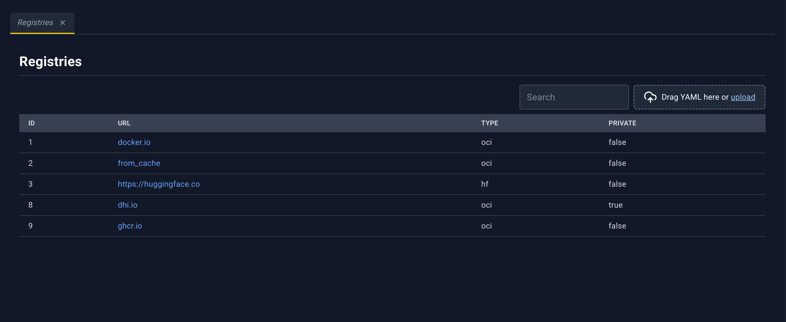

Registries hold the credentials and TLS settings used when the cluster pulls images, models, or knowledge.

| Column | What it shows |
| --- | --- |
| ID | Registry id |
| URL | Registry URL. Click to open the detail panel. |
| Type | Registry type. An empty type is shown as `oci`. |
| PRIVATE | `true` when the registry is private, `false` when it is public |

### Registry detail panel

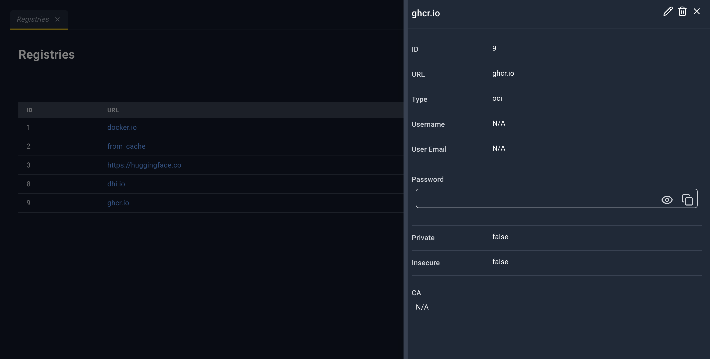

Title is the registry URL.

| Icon | Name | What happens |
| --- | --- | --- |
| Pencil | Edit | Registry YAML in the bottom drawer. Save updates the registry. |
| Trash | Delete | **Deleting Registry {url or id}**. The message explains the registry is removed when nothing still uses it. |
| X | Close | Closes the panel. |

Fields: **ID**, **URL**, **Type**, **Username**, **User Email**, **Password** (hidden, with reveal and copy), **Private**, **Insecure**, **CA**.

**CA** shows the certificate as stored. The eye (**Toggle visibility**) decodes it to PEM text. **Copy to clipboard** copies the visible value and briefly reads **Copied!**.

There are no links to other resources inside this panel. Catalog items, models, and knowledge link here.

## Catalog Microservices

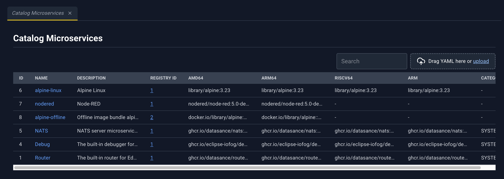

A catalog item is a named microservice image, with up to one image per architecture, that templates and workloads can reference.

| Column | What it shows |
| --- | --- |
| ID | Catalog id |
| Name | Name. Click to open the detail panel. |
| Description | Description |
| Registry Id | Link to Registries for that registry |
| amd64, arm64, riscv64, arm | Image for that architecture, or `-` |
| Category | Category, including system catalog items |

### Catalog detail panel

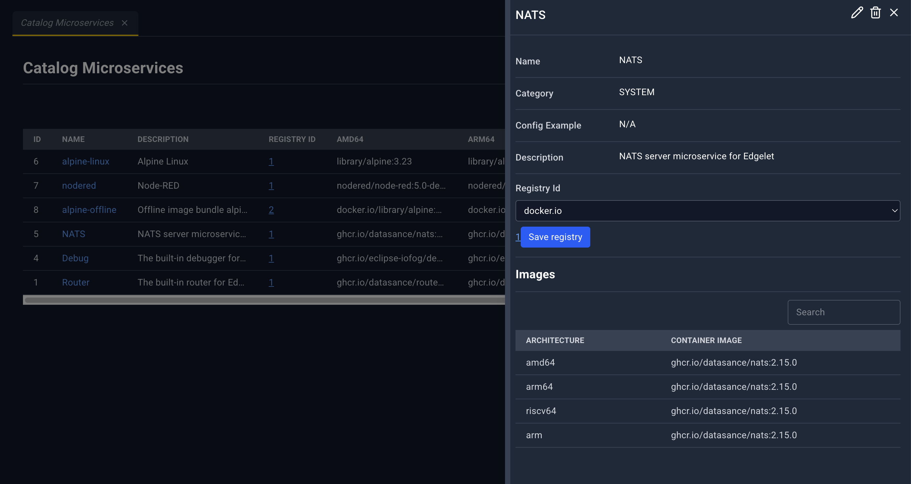

Title is the catalog name.

| Icon | Name | What happens |
| --- | --- | --- |
| Pencil | Edit | Catalog item YAML. Save updates the item. |
| Trash | Delete | **Deleting Catalog Microservice {name}**. The message covers system category and in-use cases. |
| X | Close | Closes the panel. |

Fields: **Name**, **Category**, **Config Example**, **Description**, **Registry Id**, then section **Images** with **Architecture** and **Container Image**.

**Registry Id** is a picker, not only a label.

- The first option is **Select an image registry**. The list is OCI registries.
- The current registry is a link to the Registries page.
- **Save registry** (or **Saving…** while the request runs) writes the choice. It stays disabled until an OCI registry is selected.

A loading overlay can say **Catalog Updating...** or **Catalog Adding...** during those writes.

## AI Model Catalog

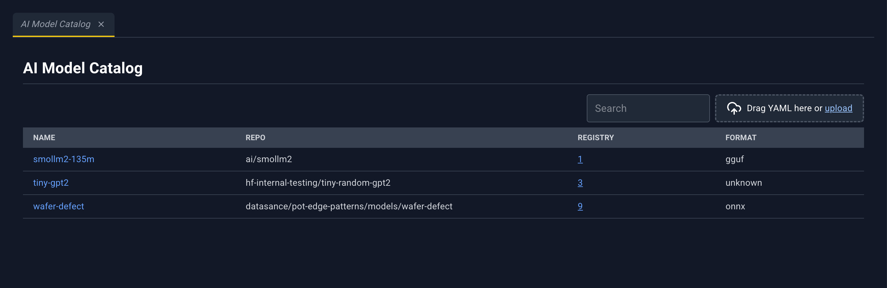

Fleet catalog of AI models. Linking a model to an edgelet makes it available for microservices on that node to mount. The microservice page is where you attach a catalog model to a container; this page is where you attach it to nodes.

| Column | What it shows |
| --- | --- |
| Name | Model name. Click to open the detail panel. |
| Repo | Repository |
| Registry | Link to Registries |
| Format | Model format |

### Model detail panel

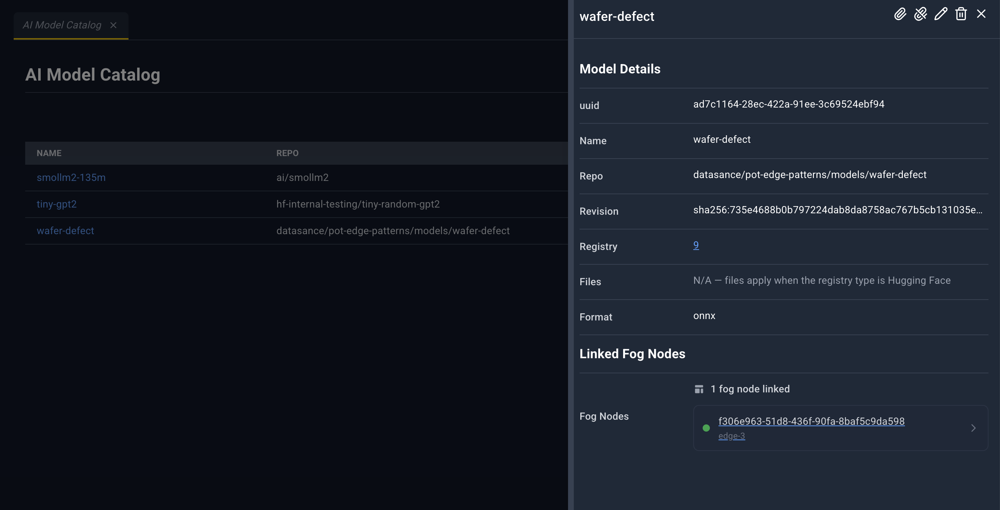

Title is the model name.

| Icon | Name | What happens |
| --- | --- | --- |
| Paperclip | Attach | **Attach {name}**. Multi-select **Select agent(s) to attach...**. Confirm **Attach**. Toast **Model Attached**. |
| Broken paperclip | Detach | **Detach from {name}**. **Select agent(s) to detach...**. Confirm **Detach**. Toast **Model Detached**. |
| Pencil | Edit | Model YAML. For a Hugging Face registry, the YAML includes the file list. |
| Trash | Delete | **Deleting Model {name}**. A model still bound to microservices can be refused. |
| X | Close | Closes the panel. |

**Model Details:** **uuid**, **Name**, **Repo**, **Revision**, **Registry** (link), **Files**, **Format**.

**Files** lists files when the registry type is Hugging Face. Otherwise the value is **N/A — files apply when the registry type is Hugging Face**.

**Linked Fog Nodes** — **No fog nodes linked**, or a count and a link per edgelet to Edgelet List.

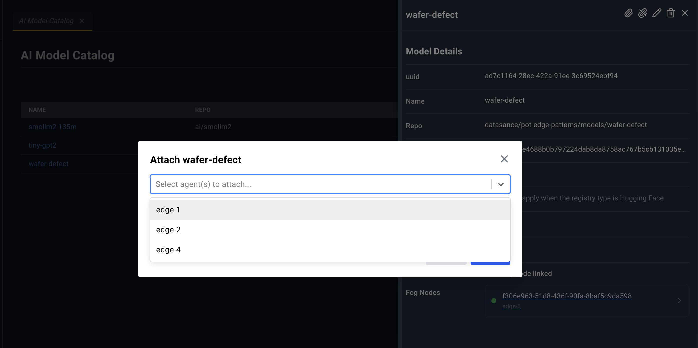

## AI Knowledge Catalog

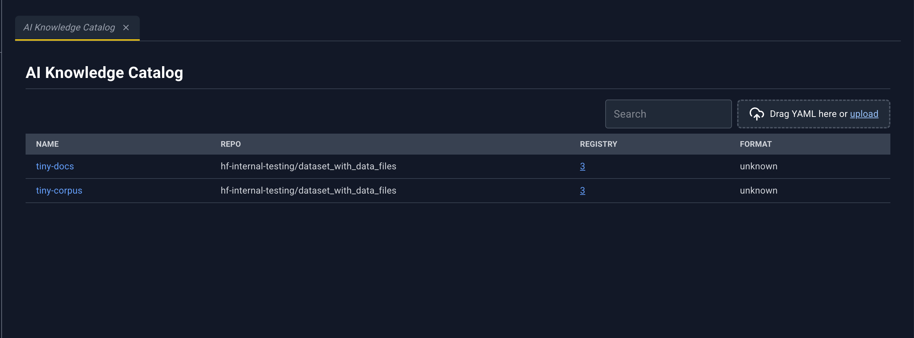

Same page shape as AI Model Catalog, for knowledge and document bundles. Any container engine can receive a knowledge attachment. The microservice editor mounts it into a user microservice.

| Column | What it shows |
| --- | --- |
| Name | Knowledge name. Click to open the detail panel. |
| Repo | Repository |
| Registry | Link to Registries |
| Format | Format |

### Knowledge detail panel

Title is the knowledge name. Icons match models: **Attach**, **Detach**, **Edit**, **Delete**, **Close**.

Toasts: **Knowledge attached**, **Knowledge detached**. Delete is titled **Deleting Knowledge {name}**.

**Knowledge Details:** **uuid**, **Name**, **Repo**, **Revision**, **Registry** (link), **Files** (same Hugging Face rule as models), **Format**, and a format hint:

> Known values: markdown, pdf, jsonl, parquet, arrow, sqlite, faiss, chroma, lance. Any other text is stored as unknown. Empty means omitted.

**Linked Fog Nodes** works the same way as on a model: each node name opens Edgelet List.

Attach and detach dialogs use the same placeholders as models.

## Application Templates

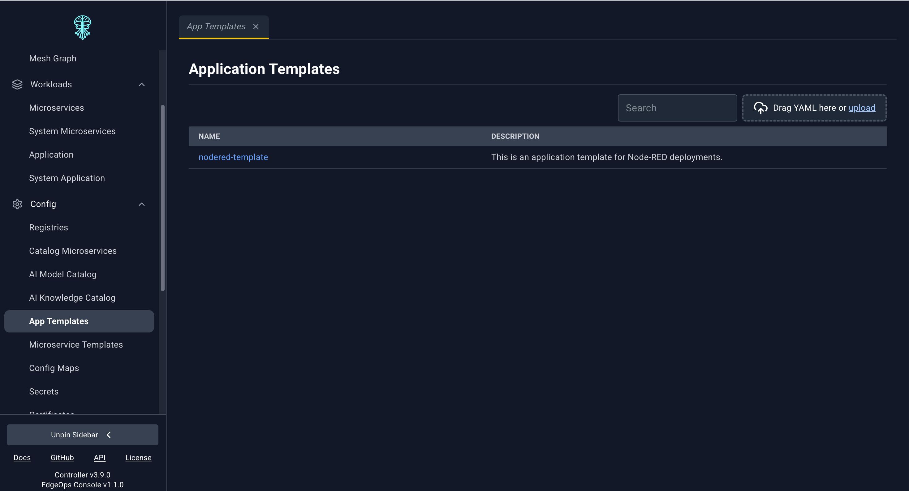

A template is a blueprint: application metadata, the microservices it will create, and variables the operator fills in at deploy time.

| Column | What it shows |
| --- | --- |
| Name | Template name. Click to open the detail panel. |
| Description | Description |

### Template detail panel

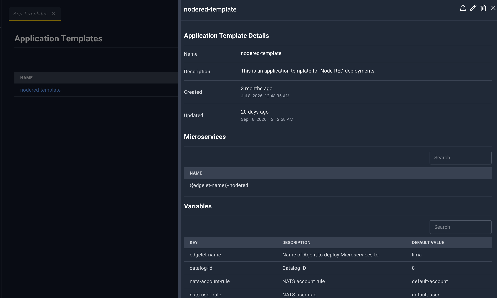

The panel opens wide. Title is the template name, or **Application Templates Details**.

| Icon | Name | What happens |
| --- | --- | --- |
| Upload | Publish | Opens the deploy form in the bottom drawer. Tab title **Application Template Form: {name}**. |
| Pencil | Edit | Application template YAML. Save updates the template. |
| Trash | Delete | **Delete {name}**. Removes the template. This does not delete applications already deployed from it. |
| X | Close | Closes the panel. |

**Application Template Details:** **Name**, **Description**, **Created**, **Updated**.

**Microservices:** a name table, or **No microservices available.**

**Variables:** **Key**, **Description**, **Default Value** (italic **No default** when empty), or **No variables available.**

### Deploy form

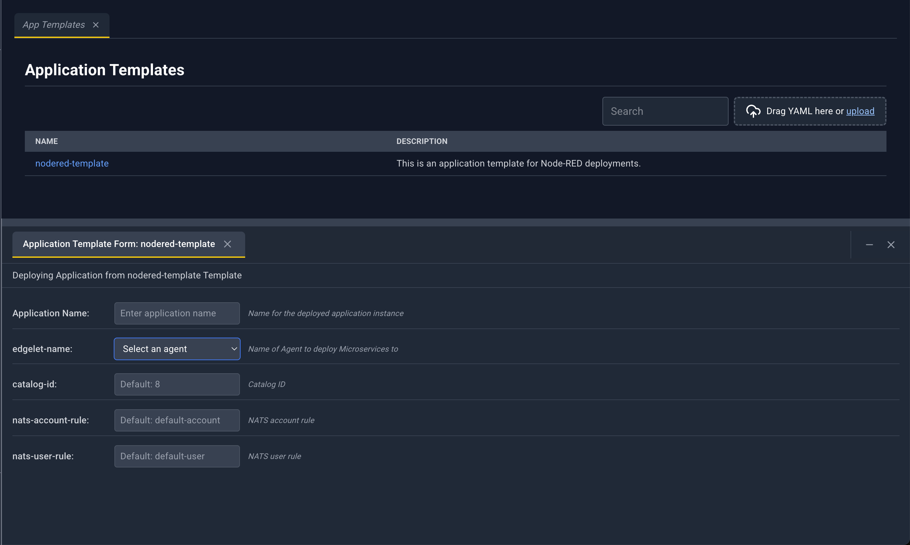

The drawer title reads **Editing Deploy an application from {name} Template**.

- **Application Name**, placeholder **Enter application name**. Help text: *Name for the deployed application instance*. Required.
- Each template variable is a row: the key, its description, and an input.
  - A variable that expects an edgelet is a **Select an agent** list of the cluster’s edgelets.
  - A boolean variable is **Select**, **true**, or **false**.
  - A read-only variable says **Variable {key} is not configurable**.

**Save** in the drawer asks **Deploy {name}**: deploy an application from this template. **Cancel** returns to the form. **Deploy** runs it. Success toast: **Application deployed!**. If the name is empty, the form reports **Application name is required**.

## Microservice Templates

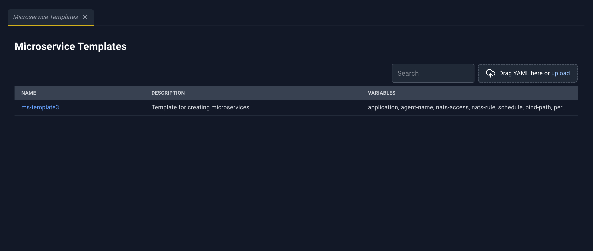

A reusable microservice definition plus variables. Deploy creates one microservice instance.

| Column | What it shows |
| --- | --- |
| Name | Template name. Click to open the detail panel. |
| Description | Description |
| Variables | Comma-separated variable keys, or `-` |

### Template detail panel

Wide panel. **Microservice Template Details:** **Name**, **Description**, and **Created** / **Updated** when those timestamps exist. **Variables** uses the same Key / Description / Default Value table as application templates.

| Icon | Name | What happens |
| --- | --- | --- |
| Upload | Publish | Drawer tab **Microservice Template Form: {name}**. |
| Pencil | Edit | Microservice template YAML. |
| Trash | Delete | **Delete {name}**. |
| X | Close | Closes the panel. |

### Deploy form

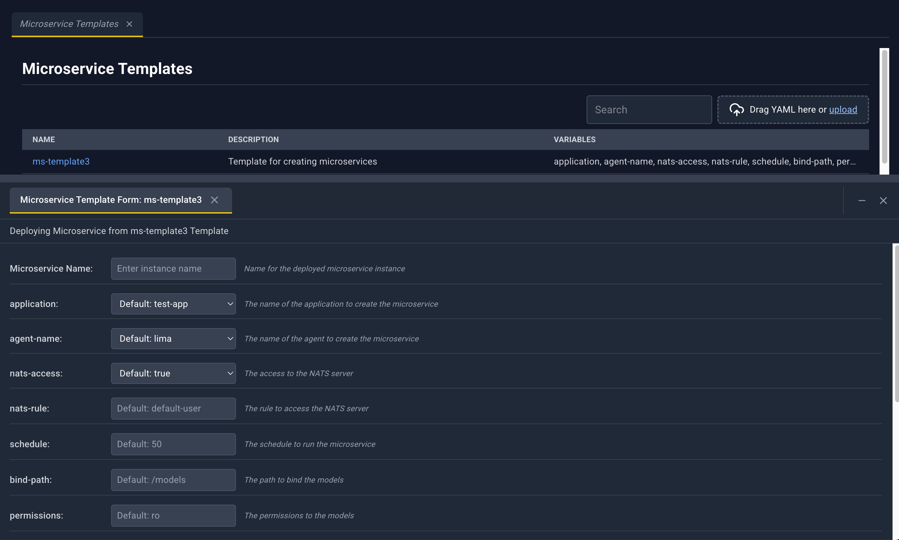

Drawer title: **Editing Deploy a microservice from {name} Template**.

- **Microservice Name**, placeholder **Enter instance name**
- **Application** — **Select an application**, unless a variable already captures the application
- **Agent** — **Select an agent**, unless a variable already captures the edgelet
- Remaining variables follow the application-template rules (agent picker, boolean, read-only)

Deploy stays unavailable until the instance name, application, and agent are all set. Confirm **Deploy {name}**. Success toast: **Microservice deployed!**.
