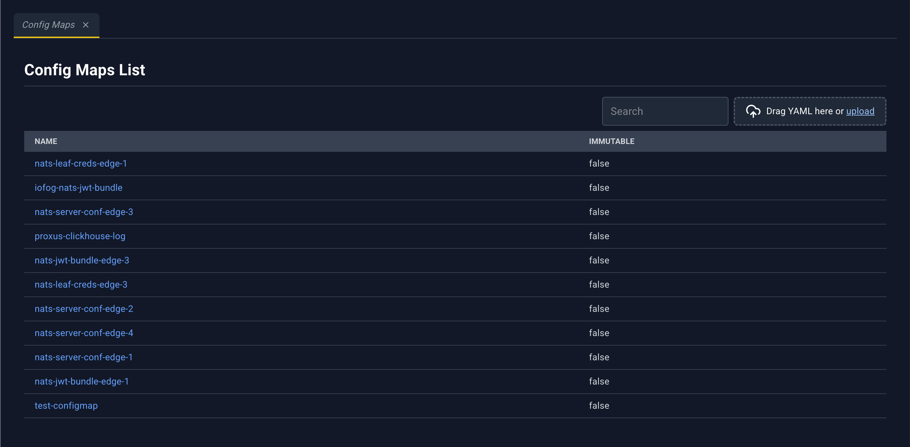
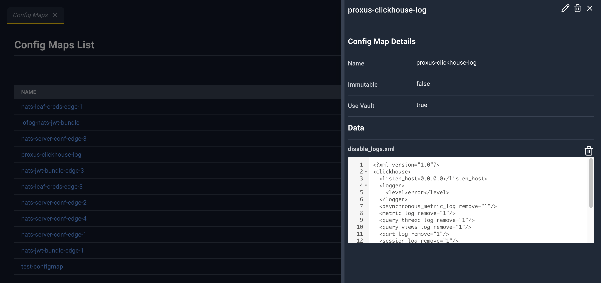
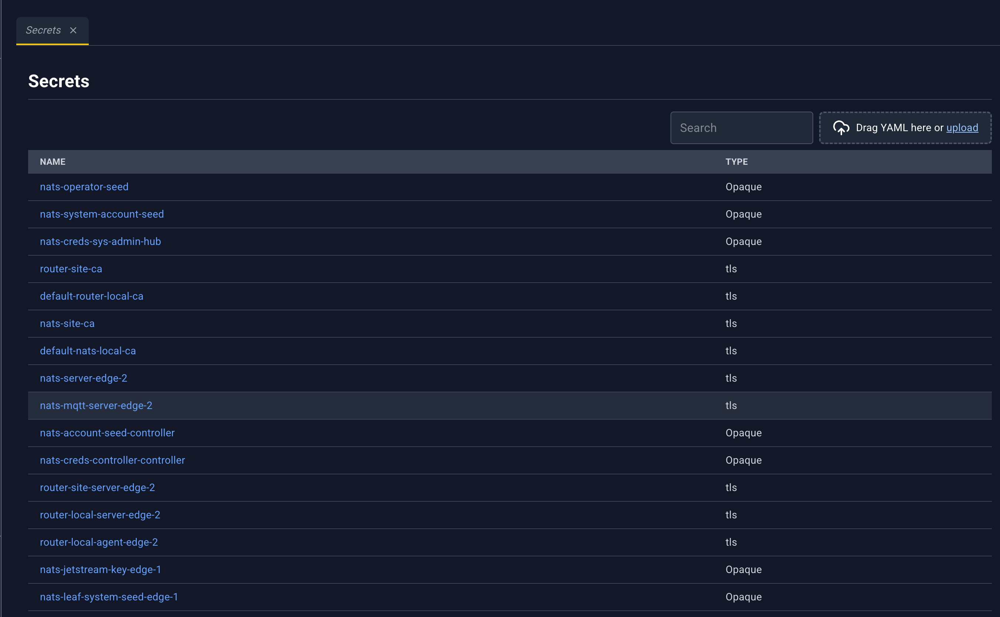
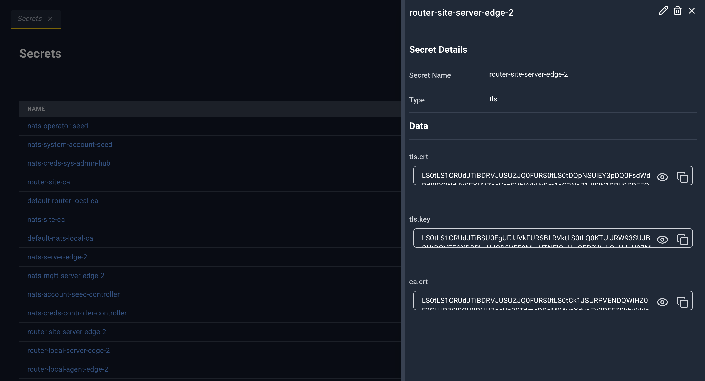
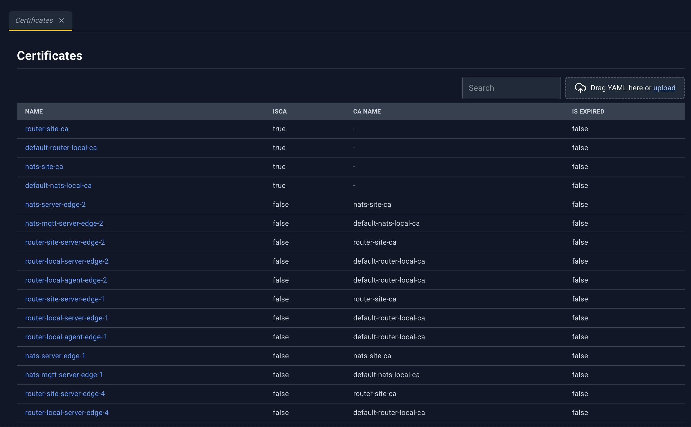
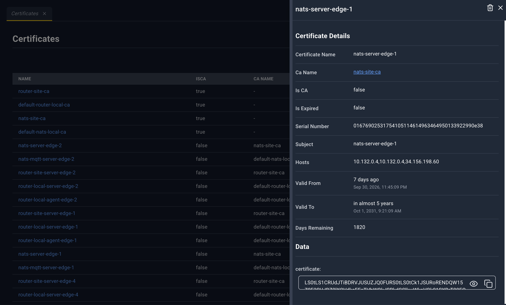
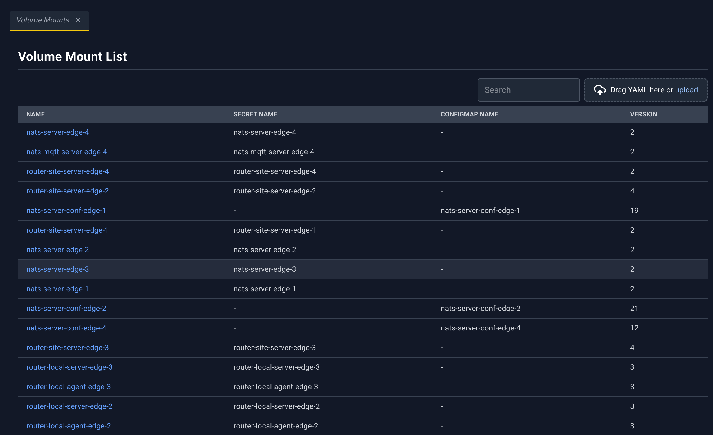
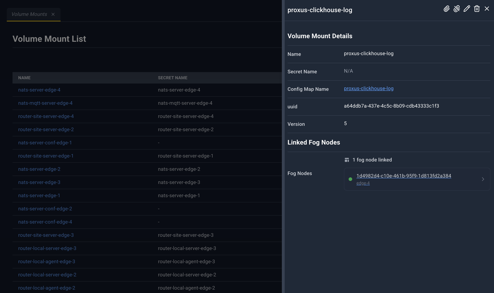
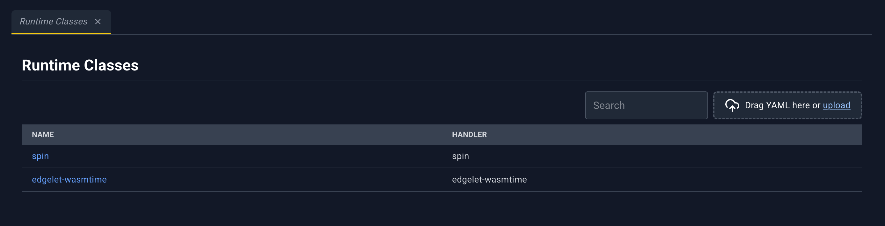
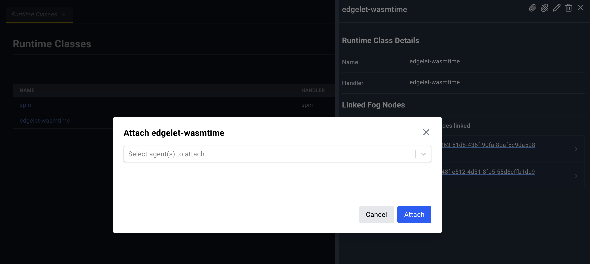

# Configuration

These pages are the rest of the Config group: data the cluster stores, and the runtime classes edgelets can run. Every list has Search and the YAML dropzone. Click the name to open the detail panel. There is no Create button; upload YAML to add a record.

| Page | Sidebar title | Address | Page heading | Deep link |
| --- | --- | --- | --- | --- |
| Config Maps | Config Maps | `/#/config/ConfigMaps` | Config Maps List | `configMapName` |
| Secrets | Secrets | `/#/config/secret` | Secrets | `secretName` |
| Certificates | Certificates | `/#/config/certificates` | Certificates | `name` |
| Volume Mounts | Volume Mounts | `/#/config/VolumeMounts` | Volume Mount List | `volumeMountName` |
| Runtime Classes | Runtime Classes | `/#/config/RuntimeClasses` | Runtime Classes | `runtimeClassName` |

Volume mounts, models, knowledge, and runtime classes share the attach pattern: the detail panel lists **Linked Fog Nodes**, and **Attach** / **Detach** change that list.

## Config Maps

Named configuration documents. Volume mounts can project a config map onto an edgelet, and microservices can consume that mount.

| Column | What it shows |
| --- | --- |
| Name | Config map name. Click to open the detail panel. |
| immutable | `true` or `false` |

### Config map detail panel

| Icon | Name | What happens |
| --- | --- | --- |
| Pencil | Edit | Full config map YAML in the bottom drawer. Save updates the config map. |
| Trash | Delete | Deletes the config map. The confirm text warns about volume mounts and microservices that still reference it. |
| X | Close | Closes the panel. |

**Config Map Details:** **Name**, **Immutable**, **Use Vault**.

**Data:** one YAML editor per key. The key is the heading. After you edit a key, a pencil saves that key. A trash icon deletes that key. This is separate from the header pencil, which edits the whole config map.

There are no outbound links in this panel. Volume mounts link here.

## Secrets

Cluster secrets, including TLS material. Volume mounts and certificates can reference them.

| Column | What it shows |
| --- | --- |
| Name | Secret name. Click to open the detail panel. |
| type | Secret type |

### Secret detail panel

| Icon | Name | What happens |
| --- | --- | --- |
| Pencil | Edit | Secret YAML in the bottom drawer. |
| Trash | Delete | Warns about volume mounts, certificates, and microservices that reference the secret. |
| X | Close | Closes the panel. |

**Secret Details:** **Secret Name**, **Type**.

**Data:** each key is a value box. TLS secrets stay masked (reveal and copy). Other types are shown as plain text with the same controls.

## Certificates

Certificates and certificate authorities.

| Column | What it shows |
| --- | --- |
| Name | Certificate name. Click to open the detail panel. |
| isCA | Whether this record is a CA |
| ca name | Issuing CA |
| Is Expired | Expiry flag |

### Certificate detail panel

| Icon | Name | What happens |
| --- | --- | --- |
| Trash | Delete | Deletes a certificate or a CA through the matching action. The message mentions volume mounts and the TLS secret. |
| X | Close | Closes the panel. |

There is no Edit icon. Existing certificates are not updated in place. To replace one, delete it and upload the new document. The uploader says this explicitly if you try to patch one. See [YAML uploader](./12-yaml-uploader.md).

**Certificate Details:** **Certificate Name**, **Ca Name** (link to Certificates for that CA), **Is CA**, **Is Expired**, **Serial Number**, **Subject**, **Hosts**, **Valid From**, **Valid To**, **Days Remaining**.

**Data:** each material key, with reveal and copy.

## Volume Mounts

A volume mount binds a secret or a config map to edgelets so microservices on those nodes can mount it.

| Column | What it shows |
| --- | --- |
| Name | Volume mount name. Click to open the detail panel. |
| Secret Name | Secret, when this mount carries a secret |
| ConfigMap Name | Config map, when this mount carries a config map |
| version | Version |

### Volume mount detail panel

| Icon | Name | What happens |
| --- | --- | --- |
| Paperclip | Attach | **Attach {name}**. Pick edgelets. Toast **Volume Mount Attached**. |
| Broken paperclip | Detach | **Detach from {name}**. Toast **Volume Mount Detached**. |
| Pencil | Edit | Volume mount YAML. |
| Trash | Delete | Deletes the volume mount. |
| X | Close | Closes the panel. |

**Volume Mount Details:** **Name**, **Secret Name** (link to Secrets), **Config Map Name** (link to Config Maps), **uuid**, **Version**.

**Linked Fog Nodes** lists each attached edgelet as a link to Edgelet List, or **No fog nodes linked**.

The agent detail panel links back to this volume mount by name.

## Runtime Classes

A runtime class names a handler an Edgelet node can use. Microservices pin a runtime by this name. Attach is limited to edgelets whose container engine is Edgelet.

| Column | What it shows |
| --- | --- |
| Name | Runtime class name. Click to open the detail panel. |
| Handler | Handler |

### Runtime class detail panel

| Icon | Name | What happens |
| --- | --- | --- |
| Paperclip | Attach | **Attach {name}**. Toast **Runtime Class Attached**. |
| Broken paperclip | Detach | **Detach from {name}**. Toast **Runtime Class Detached**. |
| Pencil | Edit | Runtime class YAML. |
| Trash | Delete | Warns when microservices still pin this runtime. |
| X | Close | Closes the panel. |

**Runtime Class Details:** **Name**, **Handler**.

**Linked Fog Nodes** links each node to Edgelet List.

In the attach list, an edgelet whose engine is not Edgelet is disabled and labeled `{name} ({engine} — Runtime Classes attach to Edgelet only)`.

The microservice **Runtime** field and the agent **Applied Runtime Classes** table both link back here.
