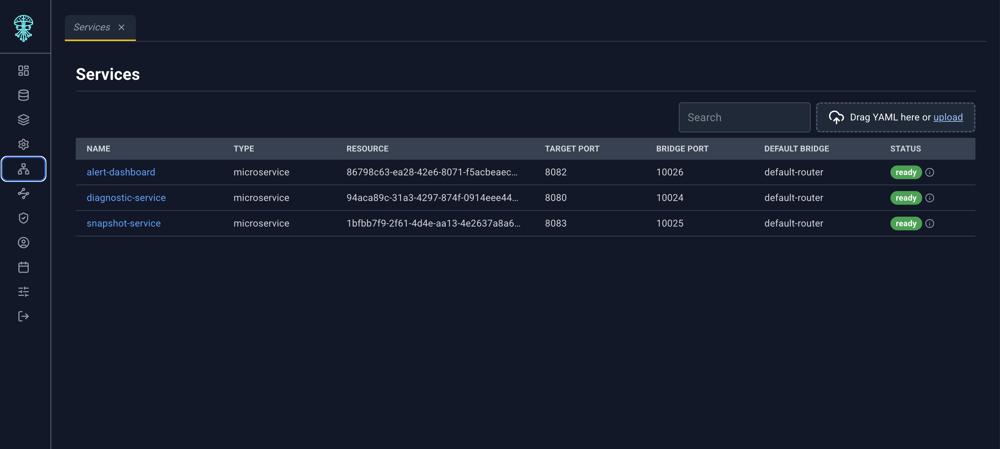
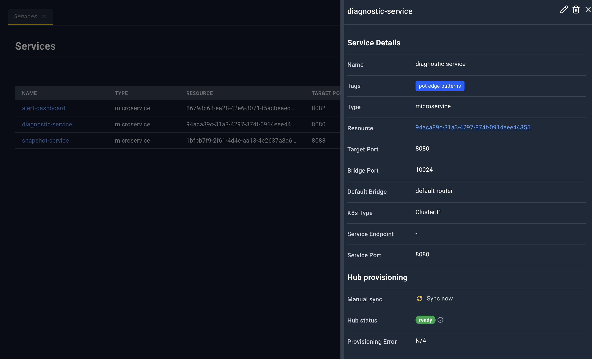

# Network

The Network group has one page: **Services**.

**Address:** `/#/config/services`  
**Deep link:** `?name=` opens that service’s detail panel.

A service publishes an edgelet or a microservice through the TCP bridge: a target port on the resource, a bridge port, and an optional Kubernetes service the hub provisions.

## Toolbar

Search and the YAML dropzone. Upload a `Service` document to create or update a service. There is no separate Create button.

## Table

| Column | What it shows |
| --- | --- |
| Name | Service name. Click to open the detail panel. |
| type | Service type |
| resource | The edgelet or microservice this service targets |
| Target Port | Port on that resource |
| Bridge Port | Port on the bridge |
| Default Bridge | Whether this is the default bridge |
| status | Provisioning status pill, or `-` |

## Service detail panel

The panel refreshes while it is open.

| Icon | Name | What happens |
| --- | --- | --- |
| Pencil | Edit | Service YAML in the bottom drawer. Save updates the service. A success toast notes that hub provisioning is in progress. |
| Trash | Delete | Deletes the service. |
| X | Close | Closes the panel. |

**Service Details**

| Field | Meaning |
| --- | --- |
| Name | Service name |
| Tags | Badges, or **N/A** |
| Type | Service type |
| Resource | Link. An edgelet opens Edgelet List. A microservice opens Microservices. |
| Target Port | Port on the resource |
| Bridge Port | Bridge port |
| Default Bridge | Default-bridge flag |
| K8s Type | Kubernetes service type, when set |
| Service Endpoint | Address, with **Copy to clipboard** (briefly **Copied!**) |
| Service Port | Published port |

**Hub provisioning**

- **Manual sync** — button **Sync now**. Tooltip: *Re-runs hub connector, listener, and Kubernetes service setup.*
- **Hub status** — provisioning badge
- **Provisioning Error** — error text, in red, when the last attempt failed

Creating or updating a service by YAML also reports that hub provisioning is in progress. **Sync now** is how you ask the hub to run that setup again without editing the service.
