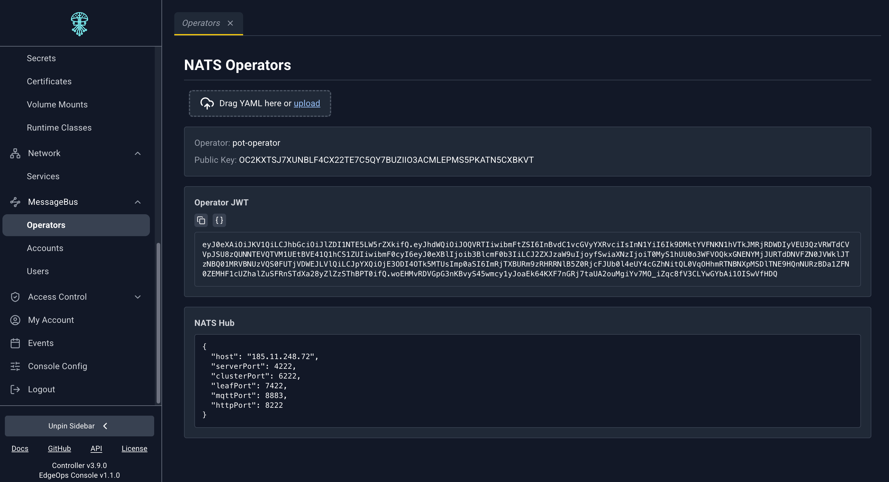
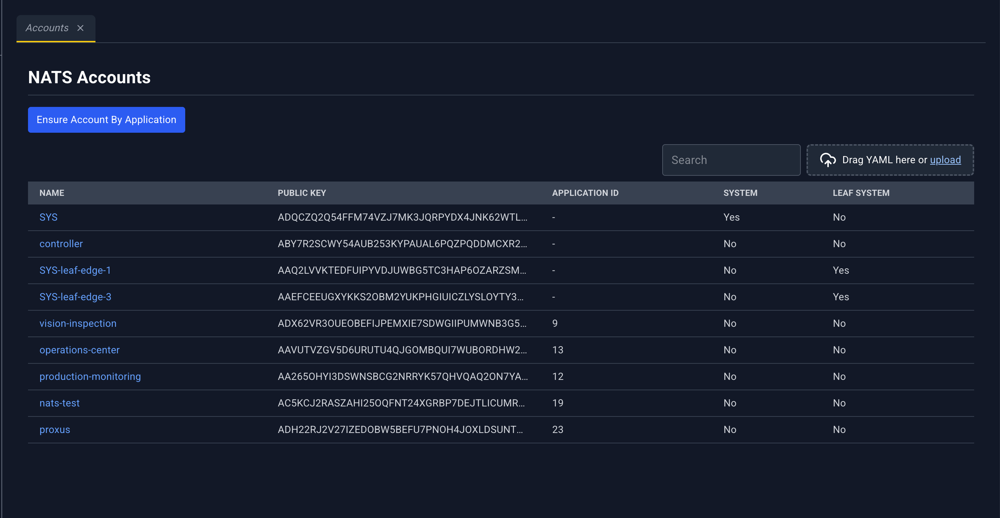
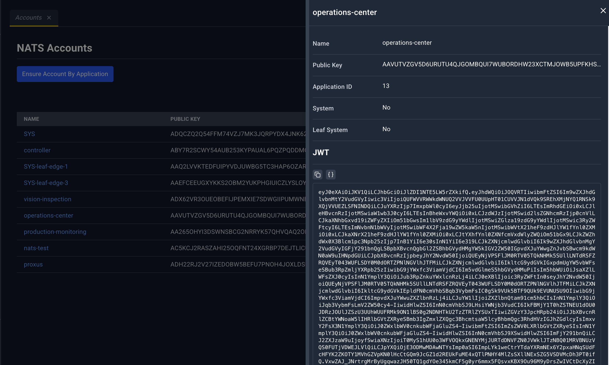
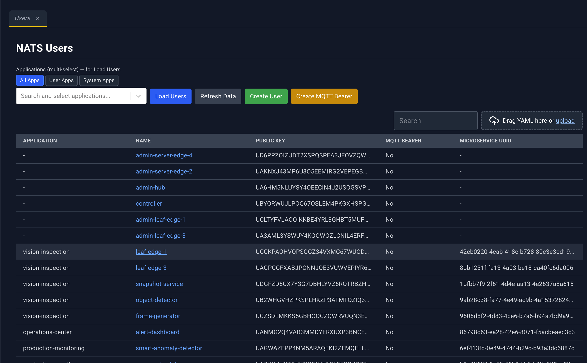
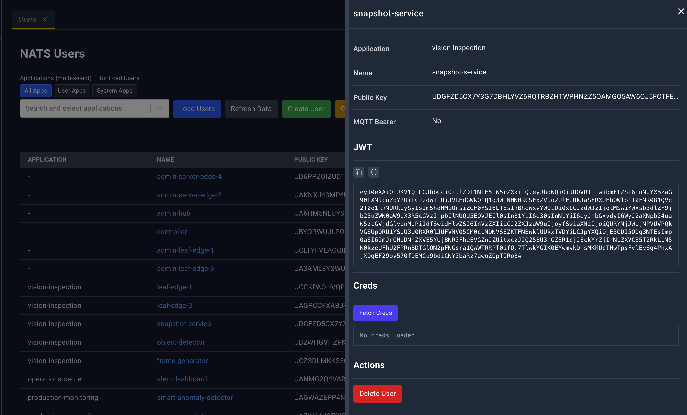

# Message bus

The MessageBus group appears only when the Controller reports that NATS is enabled. If the group is missing, this cluster has no message-bus pages.

The pages show NATS operators, accounts, and users that the platform has issued. Application and microservice detail panels link to the NATS *rules* under Access Control. Those rules are the policy. These pages are the issued credentials.

| Page | Address | Page heading |
| --- | --- | --- |
| Operators | `/#/messagebus/operators` | NATS Operators |
| Accounts | `/#/messagebus/accounts` | NATS Accounts |
| Users | `/#/messagebus/users` | NATS Users |

## Operators

This page is not a table. It shows the operator the hub is using:

- Operator name
- **Public Key**
- **Operator JWT** — a copyable block, with the decoded JWT claims
- **NATS Hub** — the hub description as JSON

The YAML dropzone is on the page. Operator rotation is not offered in the console.

## Accounts

| Column | What it shows |
| --- | --- |
| Name | Account name. Click to open the detail panel. |
| Public Key | Account public key |
| Application ID | Application this account belongs to |
| System | System account flag |
| Leaf System | Leaf-system flag |

**Ensure Account By Application** opens **Ensure NATS Account**:

- **Application Name**, placeholder `my-application`
- **NATS Account Rule (optional)**
- **Cancel** or **Ensure**

Use this when an application should have a NATS account and you want the platform to create it from an account rule.

The YAML dropzone accepts NATS account material the uploader knows how to deploy. Account-rule YAML is more often uploaded from Access Control; a successful upload there refreshes these lists when you have them open.

### Account detail panel

The panel repeats **Name**, **Public Key**, **Application ID**, **System**, and **Leaf System**, then a **JWT** section you can copy.

Header icons on this panel are **Close**. Edit and Delete are not offered here; account lifecycle goes through **Ensure** and through rule changes under Access Control.

## Users

NATS users are loaded per application, because a cluster can have many of them.

### Filters and buttons

- **Applications (multi-select) — for Load Users** chooses which applications to query.
- Scope toggles: **All Apps**, **User Apps**, **System Apps**.
- **Load Users** fetches users for the current selection.
- **Refresh Data** reloads.
- **Create User** opens the create-user dialog.
- **Create MQTT Bearer** opens the MQTT bearer dialog.

| Column | What it shows |
| --- | --- |
| Application | Application name |
| Name | User name. Click to open the detail panel. |
| Public Key | User public key |
| MQTT Bearer | Whether this user is an MQTT bearer |
| Microservice UUID | Microservice this user is bound to, when it is a microservice user |

### Create dialogs

Create user and create MQTT bearer ask for:

- An application (picker, with the same app filters)
- A name
- `expiresIn`
- `natsRule` — which NATS user rule to apply

### User detail panel

Fields: **Application**, **Name**, **Public Key**, **MQTT Bearer**, then **JWT**.

**Creds** — **Fetch Creds** loads the credential file. Until you do, the panel says **No creds loaded**. The loaded creds are shown in a masked block.

**Actions** — **Delete User**, or **Delete MQTT Bearer** when the row is a bearer. Both ask you to confirm.

The YAML dropzone is on the list. Header icons on the detail panel are the close icon; delete lives in the **Actions** section of the panel.
