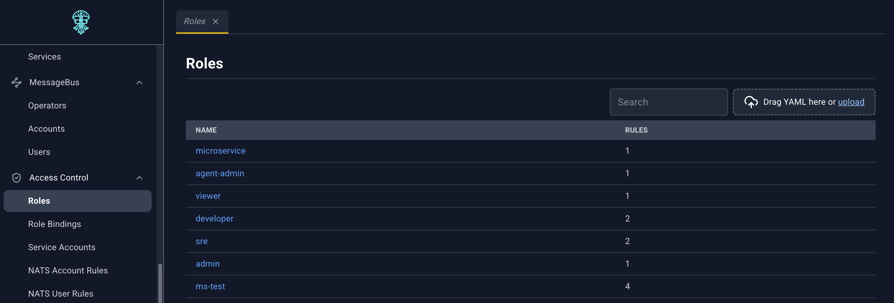
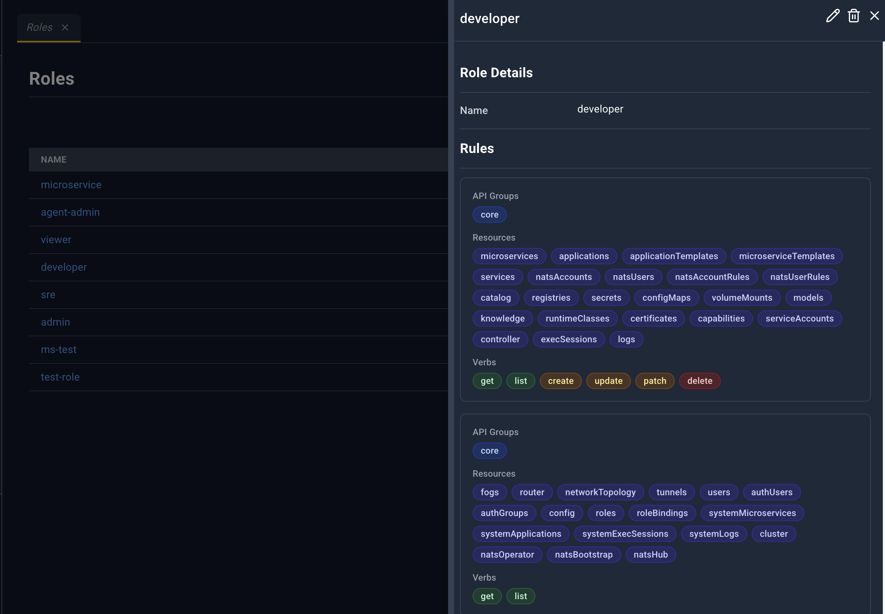
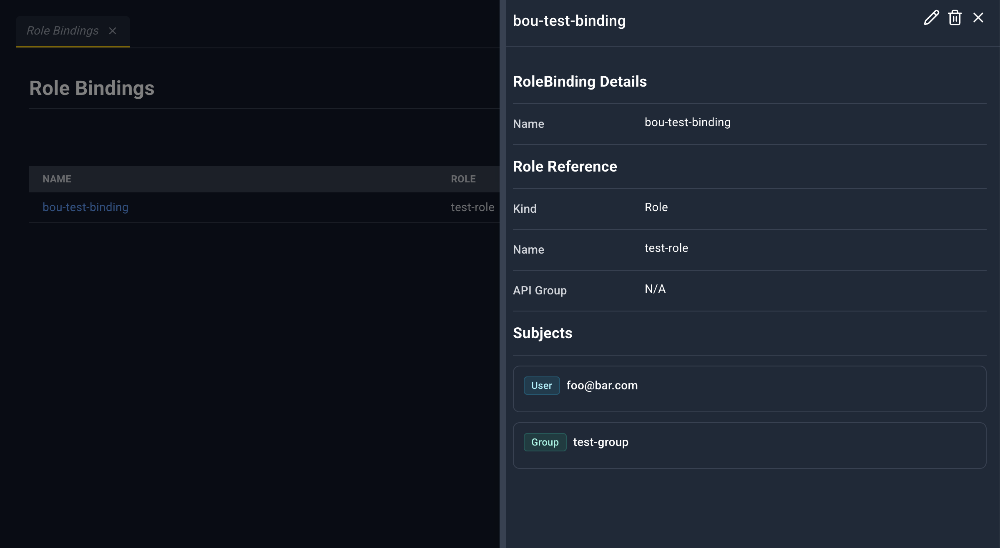
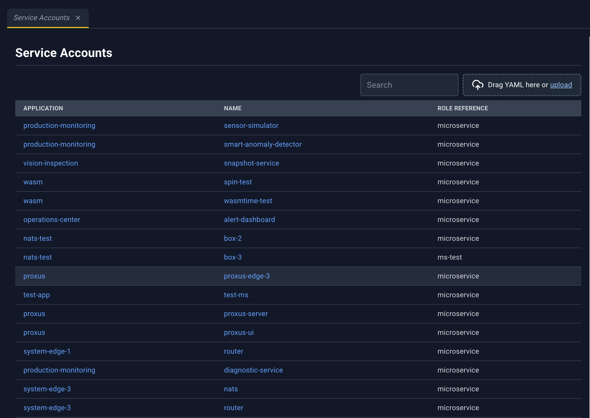
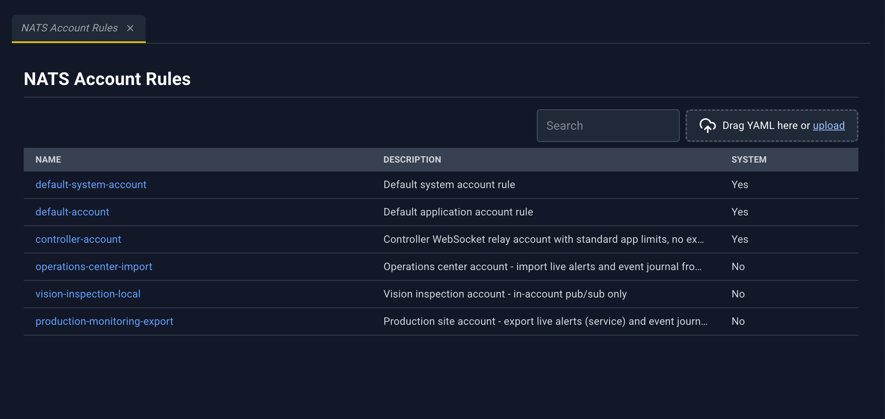
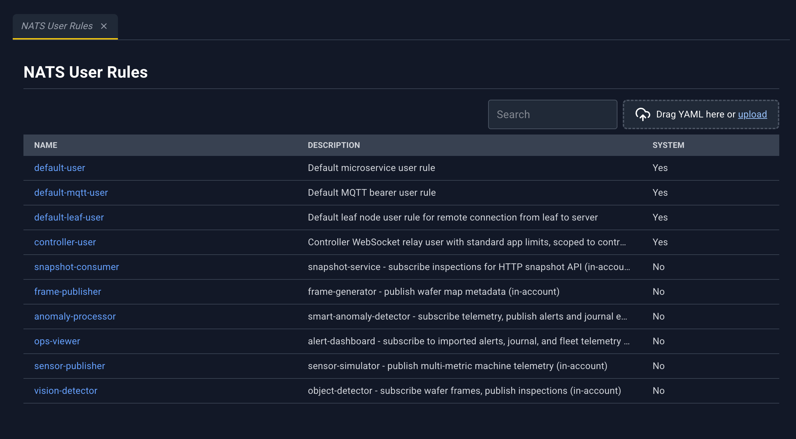

# Access control

Access Control is always in the sidebar. It is role-based access for the Controller API, plus the NATS rules that applications and microservices reference.

| Page | Address | Page heading | Deep link |
| --- | --- | --- | --- |
| Roles | `/#/access-control/roles` | Roles | `roleName` |
| Role Bindings | `/#/access-control/rolebindings` | Role Bindings | `roleBindingName` |
| Service Accounts | `/#/access-control/serviceaccounts` | Service Accounts | `serviceAccountName` |
| NATS Account Rules | `/#/access-control/nats-account-rules` | NATS Account Rules | `ruleName` |
| NATS User Rules | `/#/access-control/nats-user-rules` | NATS User Rules | `ruleName` |

Every page has Search and the YAML dropzone. Click the name to open the detail panel. Roles, role bindings, and service accounts refresh the open panel. The two NATS rule panels show the row you clicked and do not poll.

Application **NATS Config** links to an account rule. Microservice **NATS Config** links to a user rule. Both use `ruleName`.

## Roles

A role is a set of API rules: which resource types, and which verbs, a subject may use.

| Column | What it shows |
| --- | --- |
| Name | Role name. Click to open the detail panel. |
| Rules | How many rules the role contains |

Loading overlay: **Fetching Role Details**.

### Role detail panel

Title is the role name, or **Role Details**.

| Icon | Name | What happens |
| --- | --- | --- |
| Pencil | Edit | Role YAML in the bottom drawer. Save updates the role. |
| Trash | Delete | **Deleting Role {name}**. The message warns about role bindings that still point at it. |
| X | Close | Closes the panel. |

**Role Details:** **Name**.

**Rules:** each rule shows **API Groups**, **Resources**, **Verbs**, and **Resource Names**. If the role has no rules, the section says **No rules defined**.

## Role Bindings

A role binding grants a role to subjects (users, groups, or service accounts).

| Column | What it shows |
| --- | --- |
| Name | Binding name. Click to open the detail panel. |
| Role | `roleRef` name |
| Subjects | How many subjects are bound |

Loading overlay: **Fetching RoleBinding Details**.

### Role binding detail panel

Title is the binding name.

| Icon | Name | What happens |
| --- | --- | --- |
| Pencil | Edit | Role binding YAML. |
| Trash | Delete | **Deleting RoleBinding {name}**. |
| X | Close | Closes the panel. |

**RoleBinding Details:** **Name**.

**Role Reference:** **Kind**, **Name**, **API Group**.

**Subjects:** one badge per subject.

## Service Accounts

A service account belongs to an application and points at a role. Microservices can mount that identity. The mount itself shows up on the microservice as a volume of type `serviceAccount`, which the console does not let you delete.

| Column | What it shows |
| --- | --- |
| Application | Application name. Click to open the detail panel. |
| Name | Service account name. Click to open the same panel. |
| Role Reference | Role the account uses |

The deep link needs the service account name. The list row supplies the application.

Loading overlay: **Fetching ServiceAccount Details**.

### Service account detail panel

Title is `{application} / {name}`, or **ServiceAccount Details**.

| Icon | Name | What happens |
| --- | --- | --- |
| Pencil | Edit | Service account YAML. |
| Trash | Delete | **Deleting ServiceAccount {name}**. |
| X | Close | Closes the panel. |

Fields: **Application**, **Name**, then **Role Reference** (kind, name, API group) or **No role reference defined**.

## NATS Account Rules

An account rule is the policy applied when the platform ensures a NATS account for an application. Applications link to a rule by name from their NATS config.

| Column | What it shows |
| --- | --- |
| Name | Rule name. Click to open the detail panel. |
| Description | Description |
| System | **Yes** or **No** |

Loading overlay on the list: **Fetching NATS Account Rules**. The panel uses the row you clicked. It does not fetch a second record and it does not poll.

### Account rule detail panel

| Icon | Name | What happens |
| --- | --- | --- |
| Pencil | Edit | Rule YAML. |
| Trash | Delete | **Deleting NATS Account Rule {name}**. Hidden for the built-in rules below. |
| X | Close | Closes the panel. |

Fields: **Name**, **System**, **Description**, and **Rule Spec** (the rule JSON).

Delete is unavailable for:

- `default-system-account-rule`
- `default-application-account-rule`

## NATS User Rules

Same layout as account rules, for the policy applied to NATS users and MQTT bearers. Microservice NATS config links here.

| Column | What it shows |
| --- | --- |
| Name | Rule name. Click to open the detail panel. |
| Description | Description |
| System | **Yes** or **No** |

### User rule detail panel

Icons match account rules: **Edit**, **Delete** (hidden for built-in rules), **Close**.

Fields: **Name**, **System**, **Description**, **Rule Spec**.

Delete is unavailable for:

- `default-microservice-user-rule`
- `default-mqtt-bearer-user-rule`

And for the two default account-rule names if they appear in this list. The console treats that whole set as reserved.
