# Identity and sign-in

Who can open the console depends on how the Controller is configured.

- **External identity provider.** You sign in with the provider. The IAM group is hidden. My Account is a single sidebar item, and an amber banner says user and group administration is not available in the console.
- **Built-in identity.** The IAM group contains **My Account**, **Users**, and **Groups**. Administrators create users and groups here. Some users must change their password or enroll MFA before the rest of the console unlocks.

## Sign in

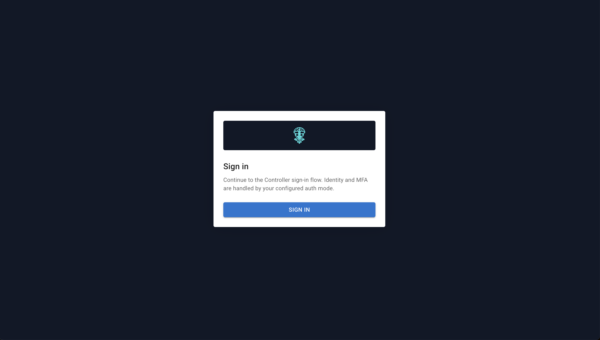

**Address:** `/#/login`

Heading **Sign in**. The page explains that the console uses the Controller’s OAuth flow. One button, **Sign in**, sends you to the provider.

If OAuth is not configured, the page says **OAuth sign-in is not configured...**. An error returned on the redirect is shown in an alert on this page.

### Username and password

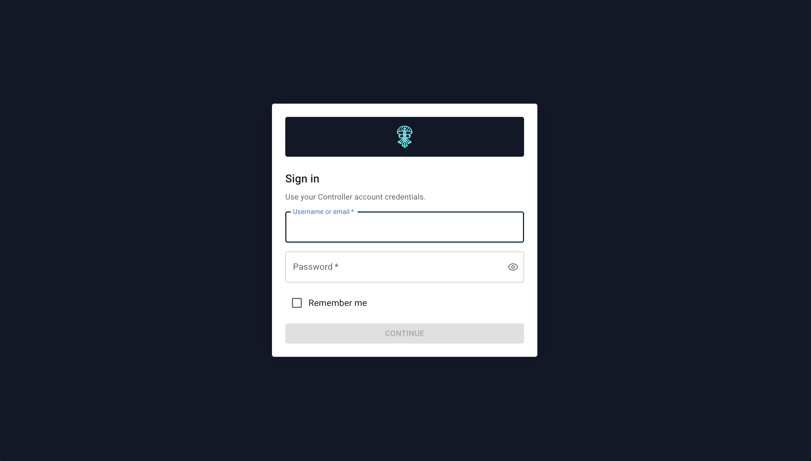

When the built-in provider asks for credentials:

- **Username or email**
- **Password**
- **Remember me**
- **Continue**

### Two-factor verification

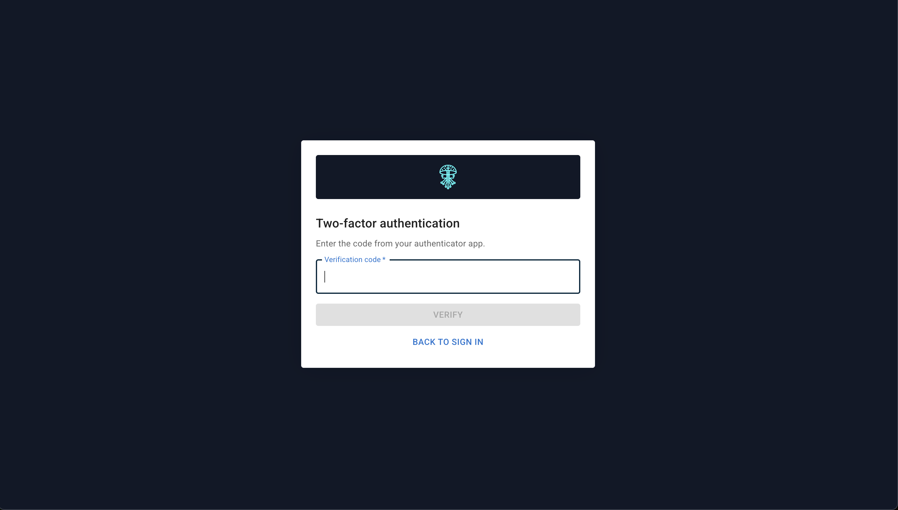

Heading **Two-factor authentication**. Enter the **Verification code** and choose **Verify**. **Back to sign in** leaves the step.

If your group requires MFA and you have not enrolled, the flow continues with **Set up two-factor authentication** (QR code, secret key, verification code, **Confirm MFA** or **Cancel**) before you reach the console.

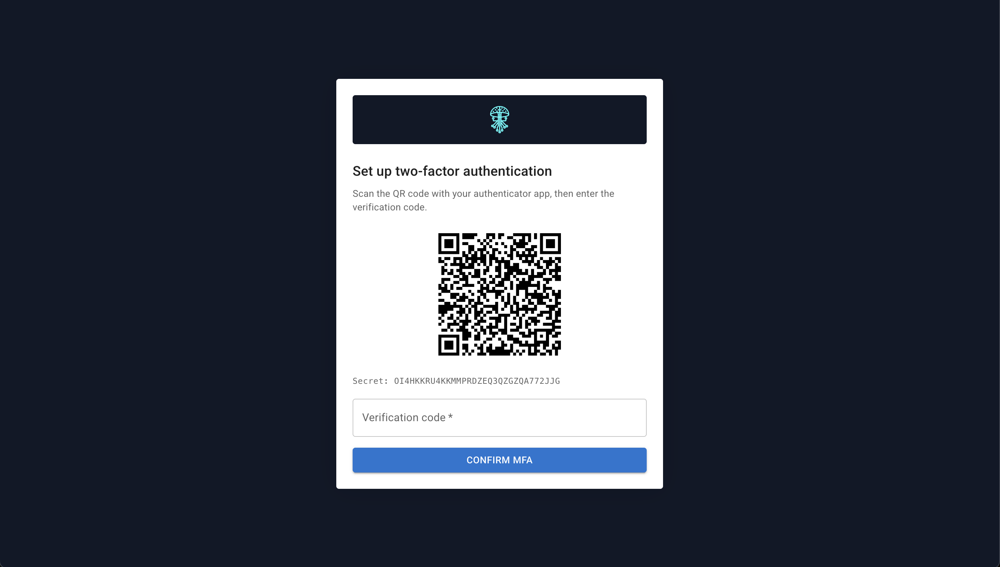

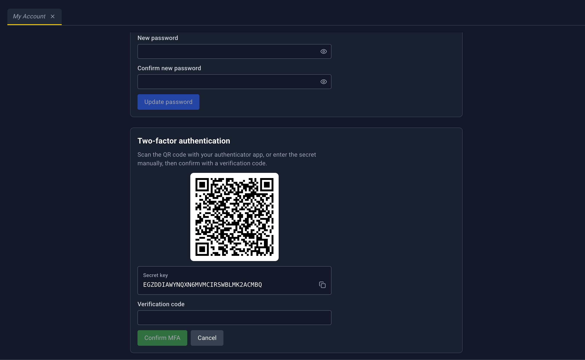

### Required password change

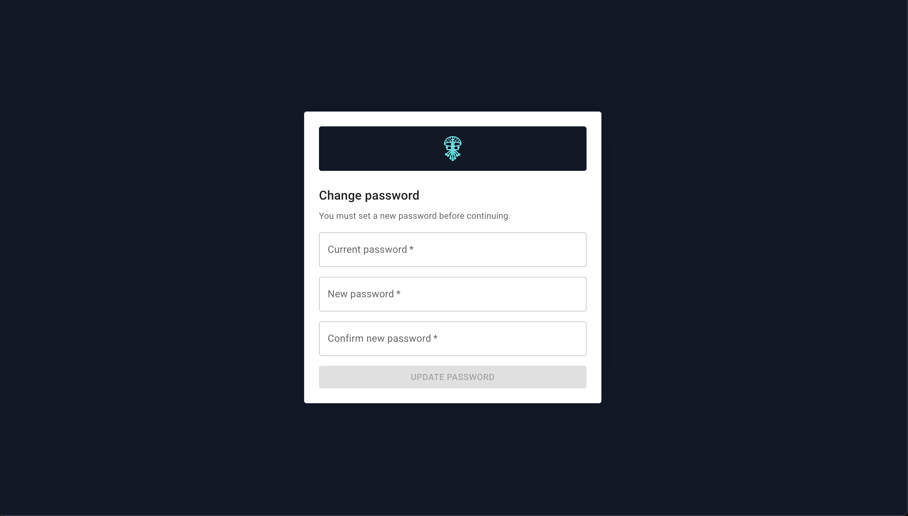

**Address:** `/#/account/force-password-change`

This page replaces the console until the password is changed. There is no sidebar and no tab bar.

Heading **Change your password**. Subtitle: *You must set a new password before continuing.*

- **Current password**
- **New password**, with **Generate random**
- **Confirm new password**
- **Update password**

After a successful change you are signed out. **Back to sign in** returns to login.

## My Account

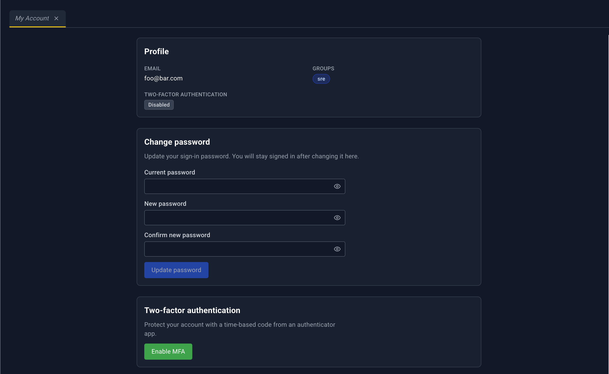

**Sidebar:** My Account (inside IAM when identity is built in, otherwise its own item)  
**Address:** `/#/account`

Heading **My Account**. Subtitle: *Manage your profile, password, and two-factor authentication.*

This page is a form, not a table, and it has no detail panel.

**Profile:** **Email**, **Username** when the profile has one, **Groups**, and **Two-factor authentication** as **Enabled** or **Disabled**.

**Change password:** **Current password**, **New password**, **Confirm new password**, **Update password**. Help text: *You will stay signed in after changing it here.* That differs from the required-change page, which signs you out.

**Two-factor authentication:**

- **Enable MFA** starts enrollment: a QR code, **Secret key**, **Verification code**, then **Confirm MFA** or **Cancel**.
- When MFA is already on, **Disable MFA** asks for a **Verification code**, then **Confirm disable** or **Cancel**.

With an external provider, this page still opens, under the amber banner. Password and MFA for that account are managed at the provider.

## Users

Shown in the sidebar only for built-in identity.

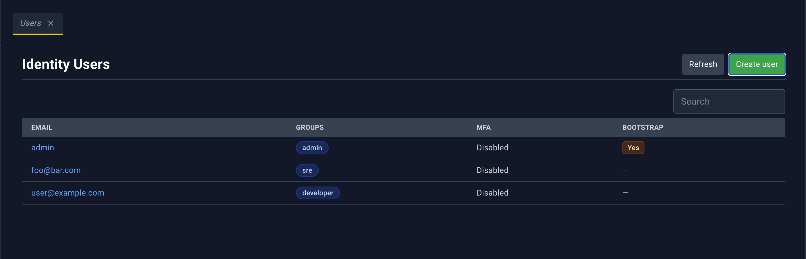

**Address:** `/#/access-control/users`  
**Page heading:** **Identity Users**  
**Deep link:** `?userId=`

There is no YAML dropzone. Users are created in a dialog.

| Control | What it does |
| --- | --- |
| Refresh | Reloads the list |
| Create user | Opens the create dialog |

| Column | What it shows |
| --- | --- |
| Email | Email. Click to open the detail panel. |
| Groups | Badges for each group |
| MFA | **Enabled** or **Disabled** |
| Bootstrap | **Yes** for the bootstrap user, otherwise — |

Loading overlay: **Loading users**.

### User detail panel

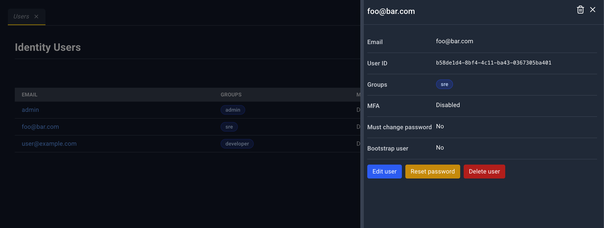

Title is the email, or **User details**. The panel refreshes while it is open.

| Icon | Name | What happens |
| --- | --- | --- |
| Trash | Delete | Same delete flow as the button inside the panel. Hidden for the bootstrap user. |
| X | Close | Closes the panel. |

There is no YAML edit icon.

Fields: **Email**, **User ID**, **Groups**, **MFA**, **Must change password**, **Bootstrap user**.

**Actions:**

- **Edit user** opens the edit dialog
- **Reset password** issues a one-time credential
- **Delete user**, or the line **Bootstrap users cannot be deleted**

### Create and edit

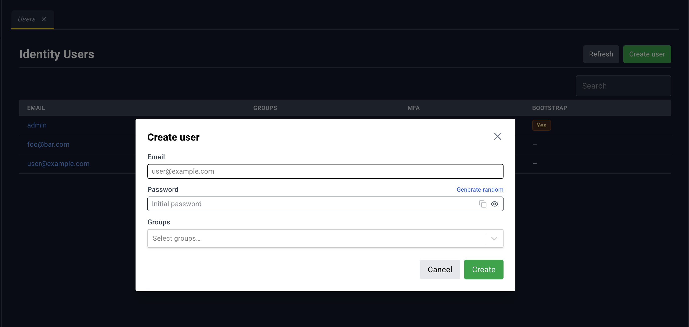

**Create user** and **Edit user**

- **Email**
- **Password**, with **Generate random**. On create, the generated password can be copied before you close the dialog.
- **Groups**, multi-select, placeholder **Select groups…**

**Delete user** warns: *This will permanently remove the user...*

**Password reset** says *Share this one-time credential...* and shows **Temporary password** and **Reset token** with copy. **Close** dismisses it.

## Groups

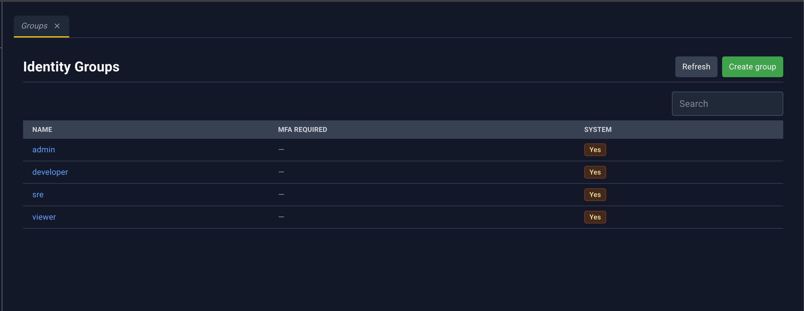

**Address:** `/#/access-control/groups`  
**Page heading:** **Identity Groups**  
**Deep link:** `?groupName=` or `?groupId=`

Groups you belong to decide whether you can edit groups. If you cannot, create, edit, and delete stay hidden and the detail panel says you do not have permission.

| Column | What it shows |
| --- | --- |
| Name | Group name. Click to open the detail panel. |
| MFA required | **Required** badge, or — |
| System | System-group marker |

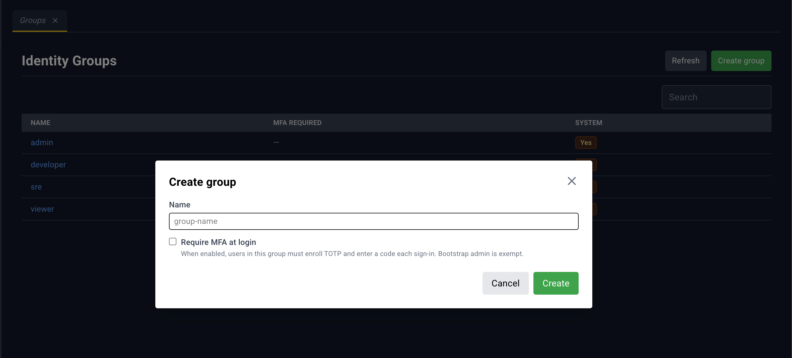

### Group detail panel

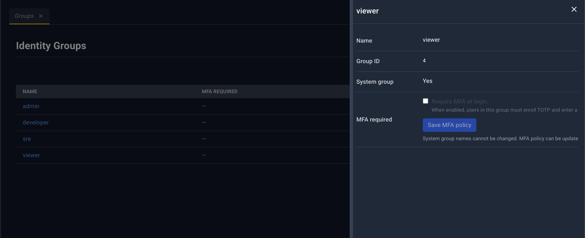

Fields: **Name**, **Group ID**, **System group**, **MFA required**.

- On a **system** group, MFA is a switch labeled **Require MFA at login** plus **Save MFA policy**.
- On a **custom** group, MFA is a badge, and the create/edit dialog is where you change it.

**Actions:** **Edit group** and **Delete group**, or a permission message.

Header **Delete** follows the same rule as the button: hidden when you cannot edit, and not offered in a way that removes a protected system group. **Close** is always there. There is no YAML editor.

### Create and edit dialog

- **Name**
- **Require MFA at login** — *When enabled, users in this group must enroll TOTP...*

**Delete group** warns that members may lose access.
