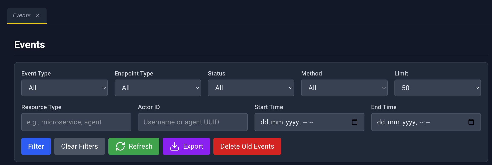
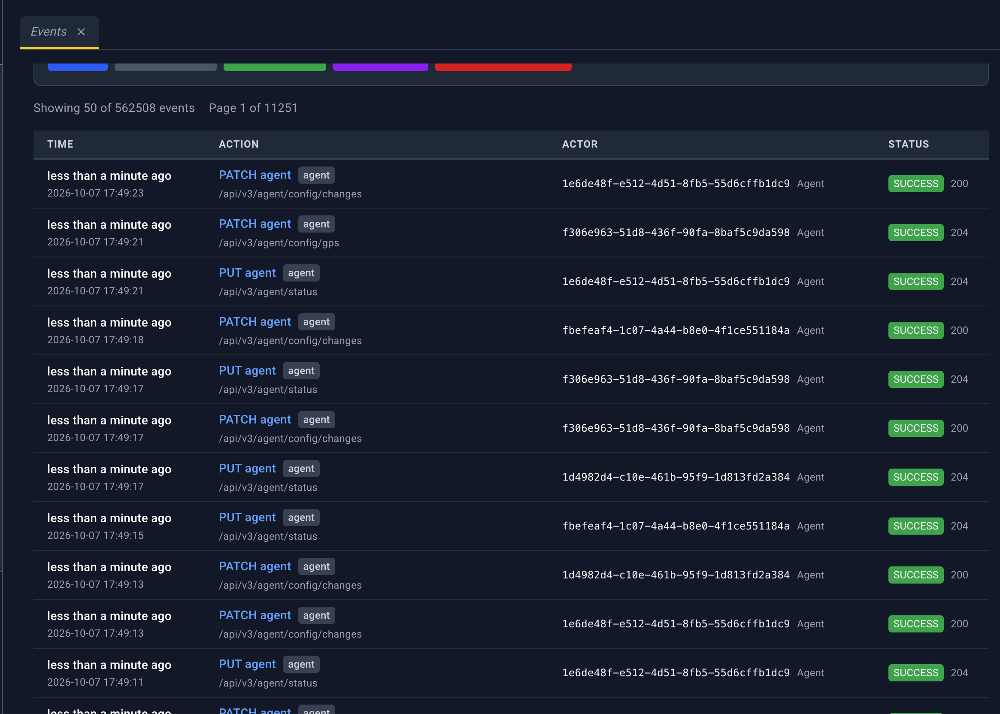
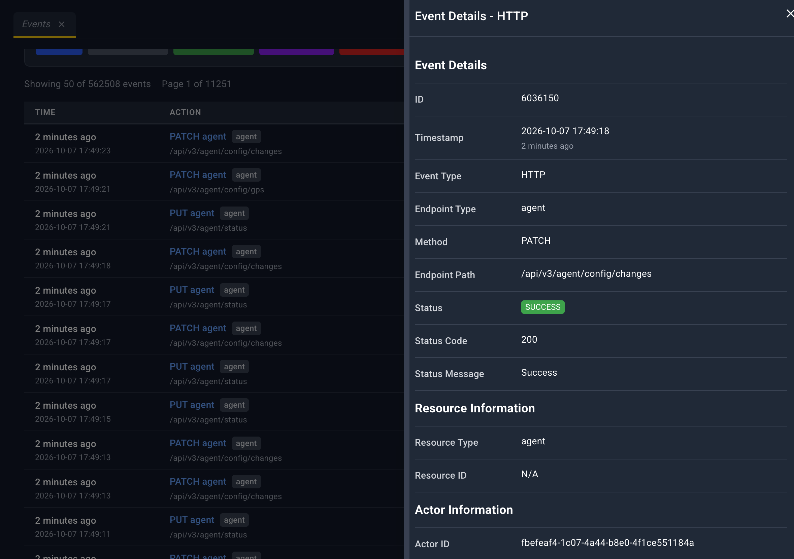
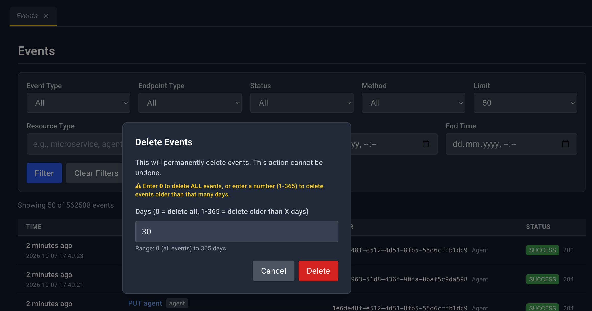
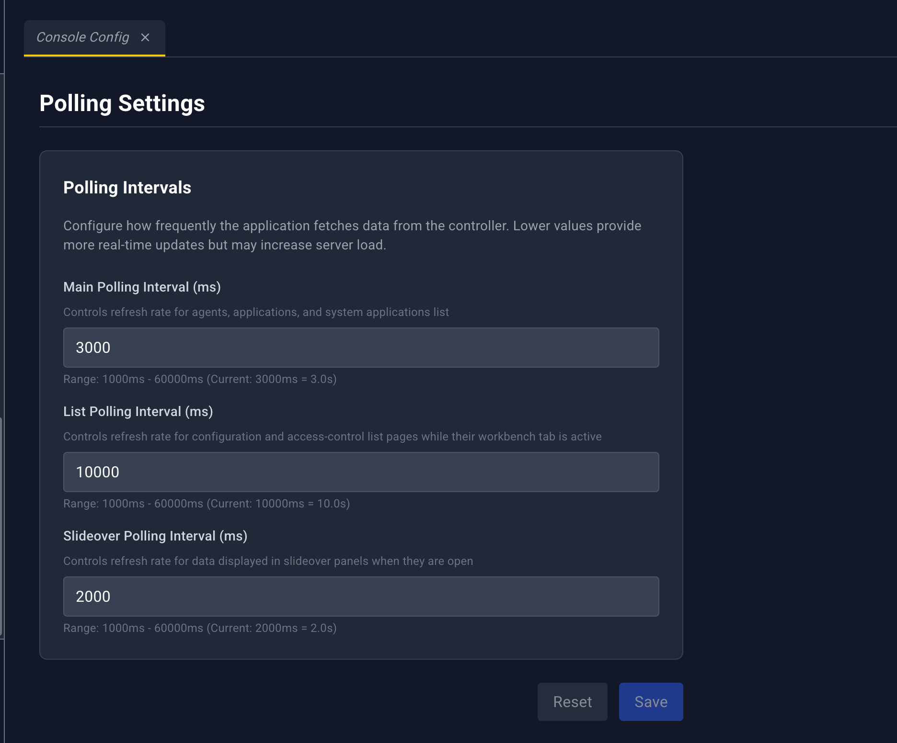
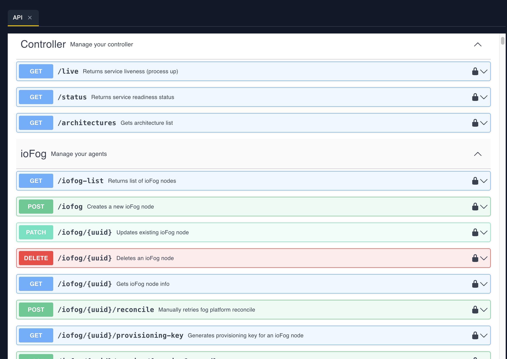

# Events, console settings, and API

Three tools sit outside the resource groups: the audit log, the polling settings, and the API explorer.

## Events

**Sidebar:** Events  
**Address:** `/#/events`  
**Page heading:** Events

Events is the audit log. It is the one list that does not use the shared table. The whole row opens the detail panel. There is no YAML dropzone, and the detail panel has no action icons other than close.

### Filters

Dropdowns apply as soon as you change them. Text fields apply when you click **Filter**.

| Filter | Choices or input |
| --- | --- |
| Event Type | All, HTTP, WebSocket Connect, WebSocket Disconnect |
| Endpoint Type | All, User, Agent |
| Status | All, Success, Failed |
| Method | HTTP method |
| Limit | Page size, from 50 to 1000 (Max) |
| Resource Type | Text. Applied with **Filter**. |
| Actor ID | Text. Applied with **Filter**. |
| Start Time | Date and time. Applied with **Filter**. |
| End Time | Date and time. Applied with **Filter**. |

| Button | What it does |
| --- | --- |
| Filter | Applies the text and time filters and reloads from the first page |
| Clear Filters | Resets every filter |
| Refresh | Reloads the current page |
| Export | **Export CSV** or **Export JSON** for the rows on the current page |
| Delete Old Events | Opens the delete dialog |

A loading overlay says **Fetching Events**.

### Table

| Column | What it shows |
| --- | --- |
| Time | Relative time, with the absolute time |
| Action | What happened |
| Actor | Who did it |
| Status | Success or failed badge |

Click anywhere on the row to open the detail panel.

Under the table: a showing-count, **First**, **Previous**, a page number with **Go**, **Next**, and **Last**.

### Event detail panel

Title: **Event Details - {event type}**. Header icons: **Close** only. The panel does not poll and it does not link to other resources.

**Event Details**

| Field | Meaning |
| --- | --- |
| ID | Event id |
| Timestamp | Absolute time, with relative time underneath |
| Event Type | HTTP, WebSocket connect, or WebSocket disconnect |
| Endpoint Type | User or agent |
| Method | HTTP method, when this is an HTTP event |
| Endpoint Path | Path that was called |
| Status | Success or failed badge |
| Status Code | HTTP status, when present |
| Status Message | Message stored with the event |

**Resource Information:** **Resource Type**, **Resource ID**.

**Actor Information:** **Actor ID**, **IP Address**.

**Request Information:** **Request ID**.

Empty values show **N/A**.

### Delete old events

> **Screenshot:** `images/events-delete.png` — the days field, including the note that 0 deletes everything.

**Delete Events** says the deletion is permanent. The field is **Days (0 = delete all, 1-365 = delete older than X days)**. Entering **0** adds the warning *This will delete ALL events in the system!* A number from 1 to 365 deletes events older than that many days.

## Console Config

**Sidebar:** Console Config  
**Address:** `/#/config/pollingSettings`  
**Page heading:** Polling Settings

This page is stored in the browser. It does not change the Controller. It sets how often this console asks for new data.

The card is **Polling Intervals**.

| Field | What it controls | Allowed range |
| --- | --- | --- |
| Main Polling Interval (ms) | Edgelets, applications, and system applications | 1000–60000 |
| List Polling Interval (ms) | Config lists and access-control lists | Same bounds, enforced on save |
| Slideover Polling Interval (ms) | An open detail panel that has refresh turned on | Same bounds, enforced on save |

**Reset** restores the last saved values. **Save** stays disabled until a field changes. A value outside 1000–60000 ms is rejected, for example *Main polling interval must be between 1000ms and 60000ms*. Success toast: **Polling settings saved successfully**.

Mesh Graph does not follow the main interval. Use **Refresh** on that page. The red Controller-unreachable banner pauses all of these timers.

## API

**Sidebar footer:** API (visible when the sidebar is expanded)  
**Address:** `/#/api`

**API** opens a pinned workbench tab. The tab loads Swagger UI for the Controller API. The console passes the current sign-in token and the API base address into that view, so **Authorize** is already set to the bearer token you are using.

While the spec loads, the page says **Loading...**. The explorer scrolls inside the tab.

Use this tab to read request and response shapes, or to try a call with the same identity as the console. Resource pages remain the supported way to do day-to-day work. YAML upload is the supported way to apply a multi-resource change. See [YAML uploader](./12-yaml-uploader.md).
